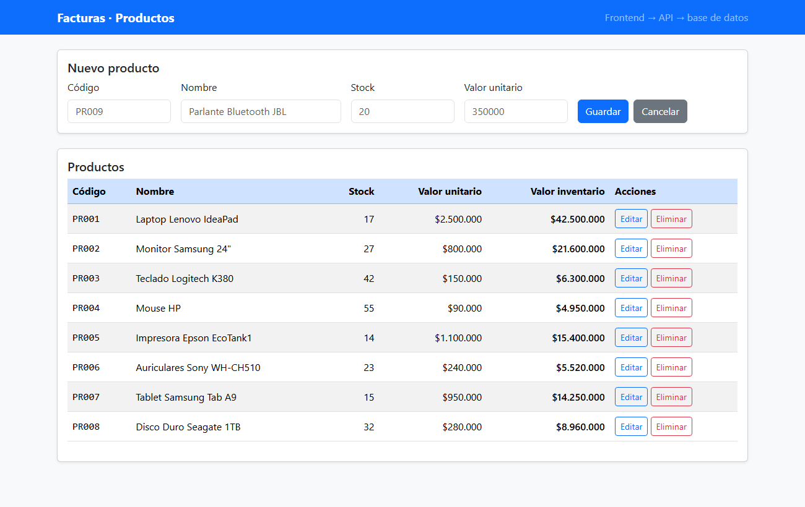
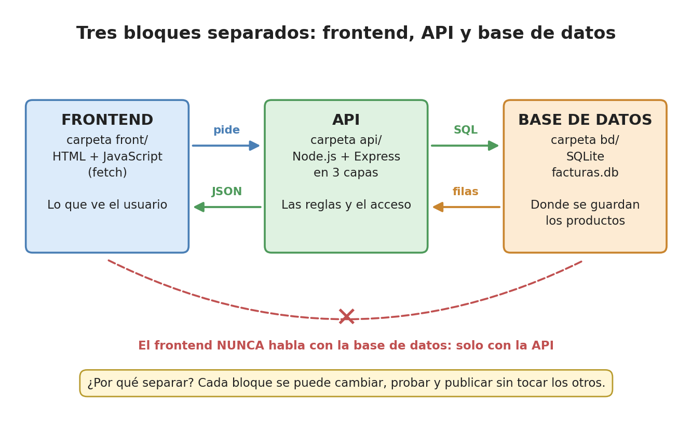
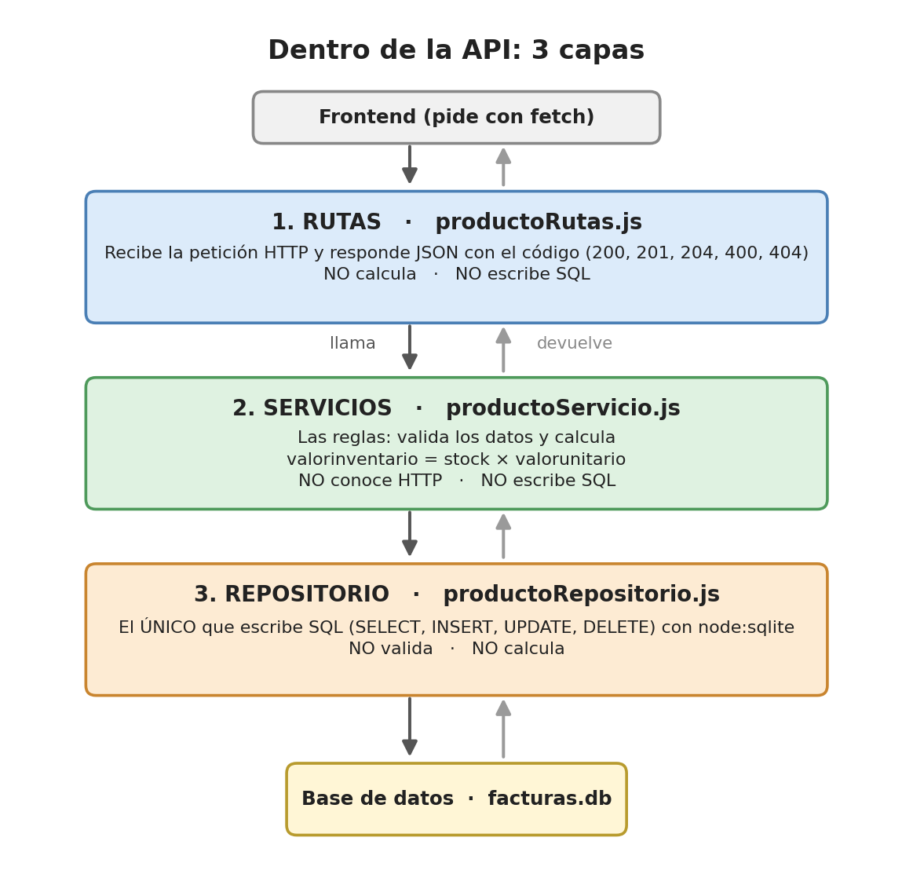
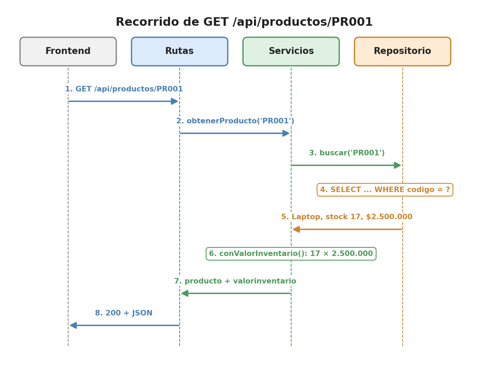
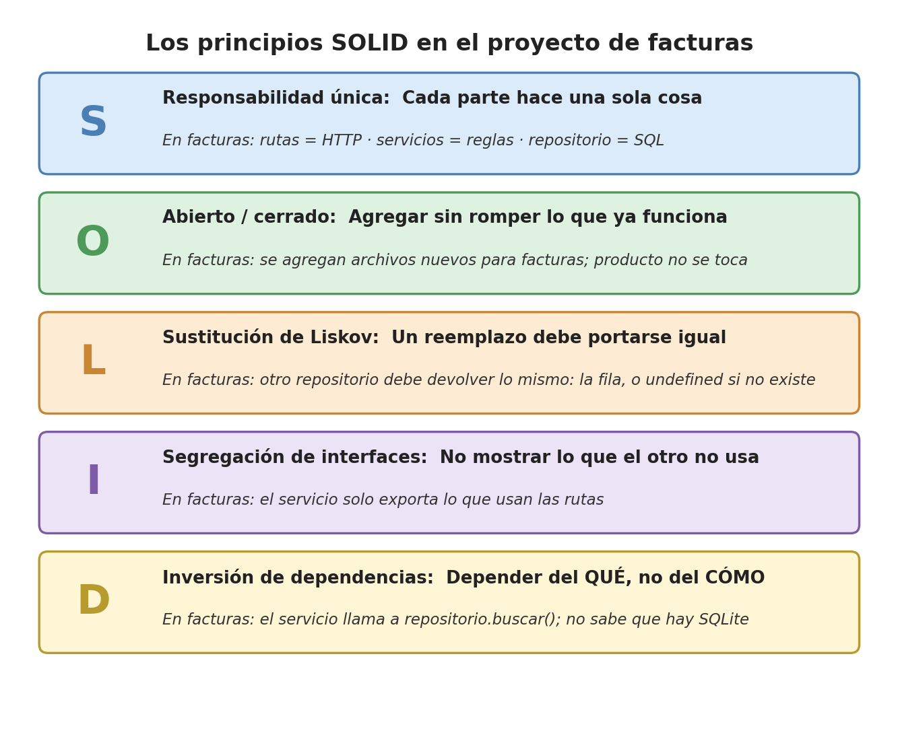
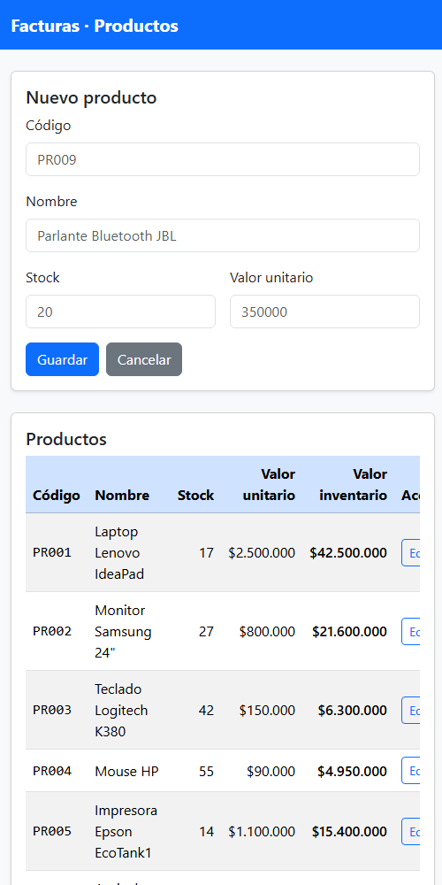
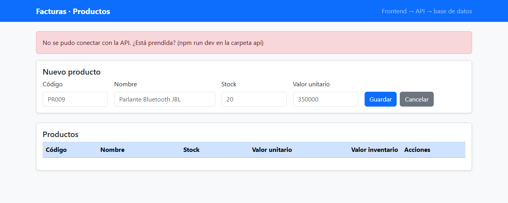

# Una aplicación web completa en tres bloques

## Base de datos, API por capas y frontend: el ejemplo de facturas

**Ingeniería Web I (PREICA2602B020082)** · Docente: Carlos Arturo Castro Castro
**Inicia la Evidencia 3 – Entrega final** · Herramientas: VS Code, Node.js, la terminal y el navegador

### ¿De qué trata esta clase?

En la Evidencia 2, los productos de la tienda estaban **escritos dentro de `tienda.js`**. Si había que agregar uno, se cambiaba el código. En una aplicación real, los datos están en una **base de datos**, y la página **se los pide** a un programa del servidor: la **API**.

Hoy construimos, **desde cero y completa**, una aplicación pequeña de **facturas**, con **una sola tabla: `producto`**. Es un ejemplo sencillo para entender cómo se arma una aplicación web de verdad. En la siguiente clase, con esta misma estructura, se construye la tienda de la Evidencia 3.

| Antes (EA2) | Ahora |
|---|---|
| Los datos están **dentro** de la página. | Los datos están en una **base de datos**. |
| Para agregar un producto se **cambia el código**. | Se agrega desde un **formulario**, y queda guardado. |
| Un solo programa: la página. | **Tres bloques** que trabajan juntos: base de datos, API y frontend. |

> **Resultado de la clase:** una carpeta `facturas-app/` con tres bloques que funcionan juntos: la **base de datos** SQLite con la tabla `producto`, la **API** con Node.js y Express organizada en **3 capas**, y el **frontend**, una página que lista, crea, modifica y elimina productos.



> 📦 **El código completo** está en el repositorio del profesor: https://github.com/ccastro2050/facturas-app

> 📚 **Los conceptos, con más calma:** en la carpeta `conceptos/`, al lado de esta guía, está explicado cada tema con imágenes: qué es una API, Node.js y npm, la programación por capas y los principios SOLID. Esta guía dice **qué hacer** y **para qué**; la carpeta `conceptos/` explica **por qué**.

---

## Mapa de la clase

| Parte | Qué se hace | Para qué |
|---|---|---|
| 0. Preparar | Comprobar Node.js, crear las carpetas e instalar REST Client | Tener todo listo antes de programar |
| 1. Conceptos | Los tres bloques, HTTP, JSON, las capas y SOLID | Entender lo que se va a construir |
| 2. Bloque 1: la base de datos | `facturas.sql` | Guardar los productos |
| 3. Bloque 2: la API | El proyecto de Node.js, las 3 capas y el servidor | Entregar y recibir los productos |
| 4. Probar la API | El navegador y `pruebas.http` | Comprobar cada endpoint, incluidos los errores |
| 5. Bloque 3: el frontend | `index.html`, `estilos.css`, `app.js` y su servidor | La página que ve el usuario, en http://localhost:3000 |
| 6. Seguridad y Git | `npm audit`, `.gitignore` y commit | Dejarlo listo en el repositorio |

## Resumen de los pasos

| # | Sección | Qué se hace | Resultado esperado |
|---|---|---|---|
| 1 | 0.1 | `node -v` y `npm -v` | `v22...` o más |
| 2 | 0.2 | Crear las carpetas de los 3 bloques | Las carpetas en el EXPLORER |
| 3 | 0.3 | Instalar REST Client | Aparece en Extensions |
| 4 | 2.1 | Crear `bd/facturas.sql` | — |
| 5 | 3.1 | `npm init -y` | Se crea `package.json` |
| 6 | 3.2 | `npm pkg set ...` | Los scripts `crear-bd` y `dev` |
| 7 | 3.3 | `npm install express cors` | `found 0 vulnerabilities` |
| 8 | 3.4 | Crear `crearBd.js` y `npm run crear-bd` | `Base de datos creada ... con 8 productos.` |
| 9 | 3.5 a 3.7 | Crear las 3 capas | — |
| 10 | 3.8 | Crear `servidor.js` | — |
| 11 | 3.9 | `npm run dev` | `API de facturas en http://localhost:3001` |
| 12 | 4.1 y 4.2 | Probar en el navegador y con `pruebas.http` | Códigos 200, 201, 204, 400 y 404 |
| 13 | 5.1 a 5.5 | Crear el frontend, prenderlo con `npm start` y abrir http://localhost:3000 | La tabla con los 8 productos |
| 14 | 6.1 y 6.2 | `npm audit`, `.gitignore`, commit y push | `found 0 vulnerabilities` |

---

## Parte 0 · Preparar

### 0.1 Comprobar que Node.js está instalado

**¿Para qué?** La API es un programa de JavaScript que corre **fuera del navegador**. Para eso se necesita **Node.js**, versión **22 o superior**. Node.js trae también **SQLite**, la base de datos que usaremos.

Abran VS Code, abran la terminal con **Ctrl + ñ** y escriban:

```powershell
node -v     # muestra la version de Node.js
npm -v      # muestra la version de npm, el instalador de librerias que viene con Node.js
```

**Resultado** (los números pueden ser mayores):

```text
v24.13.0
11.6.2
```

| Lo que aparece | Qué significa |
|---|---|
| `v24.13.0` | La versión de Node.js. Sirve cualquiera desde la 22. |
| `11.6.2` | La versión de **npm** (*Node Package Manager*, gestor de paquetes): el programa que descarga librerías como Express. |

> ⚠️ **Si sale `node : El término 'node' no se reconoce...`**, Node.js no está instalado. Descarguen la versión **LTS** de https://nodejs.org, instálenla con las opciones por defecto, **cierren VS Code y vuelvan a abrirlo**, y repitan.

### 0.2 Crear las carpetas de los tres bloques

**¿Para qué?** Cada bloque va en **su propia carpeta**, para que quede claro qué es cada cosa y no se mezclen. Dentro de la API, cada **capa** tiene también su carpeta.

Creen una carpeta para la clase, ábranla en VS Code (**Archivo → Abrir carpeta**) y, con el botón **Nueva carpeta** del EXPLORER, creen:

```text
facturas-app/                   # la aplicacion completa
├── bd/                         # BLOQUE 1: la base de datos (SQLite)
├── api/                        # BLOQUE 2: la API (Node.js + Express)
│   └── src/                    # el codigo fuente de la API
│       ├── rutas/              # CAPA 1: recibe las peticiones HTTP y responde en JSON
│       ├── servicios/          # CAPA 2: las reglas del negocio (validar y calcular)
│       └── repositorios/       # CAPA 3: el SQL: lee y escribe en la base de datos
└── front/                      # BLOQUE 3: el frontend (HTML + CSS + JavaScript), con su servidor en el puerto 3000
```

### 0.3 Instalar la extensión REST Client

**¿Para qué?** El navegador solo hace peticiones **GET** (pedir datos) al escribir una dirección. Para probar **crear, modificar y borrar** se necesita otra herramienta. **REST Client** permite escribir las peticiones en un archivo y enviarlas con un clic.

1. En VS Code, clic en **Extensions** (los cuatro cuadros, a la izquierda), o **Ctrl + Shift + X**.
2. Busquen **REST Client** (autor: *Huachao Mao*).
3. Clic en **Install**.

---

## Parte 1 · Conceptos

**¿Para qué?** Para entender **qué** se va a construir antes de escribir el código. Cada tema está explicado con más detalle en la carpeta `conceptos/`.

### 1.1 Los tres bloques, y por qué van separados



| Bloque | Carpeta | Qué es | Su trabajo |
|---|---|---|---|
| **1. Base de datos** | `bd/` | SQLite: un archivo, `facturas.db` | **Guardar** los productos, aunque se apague el computador |
| **2. API** | `api/` | Un programa de Node.js con Express | **Entregar y recibir** los productos, y aplicar las reglas |
| **3. Frontend** | `front/` | Una página HTML con JavaScript | **Mostrar** los productos y el formulario al usuario |

**¿Por qué tres bloques separados y no uno solo?**

| Razón | Ejemplo en facturas |
|---|---|
| **Cada uno se puede cambiar sin tocar los otros** | Se puede rediseñar la página por completo, y la API y la base de datos siguen iguales. Mañana el frontend se hace con React, **y la API no cambia**. |
| **Seguridad** | El frontend corre en el computador del usuario: cualquiera puede ver su código. Si hablara directo con la base de datos, cualquiera podría borrarla. Por eso **el frontend nunca toca la base de datos**: solo la API. |
| **Varios frontends, una sola API** | La misma API puede atender a la página web, a una aplicación de celular y a otro sistema. |
| **Se prueban por separado** | La API se prueba con REST Client, **sin** frontend. Si algo falla, se sabe en qué bloque está. |

> 💡 **Como en un restaurante:** el **cliente** (frontend) pide en la mesa; el **mesero y la cocina** (API) toman el pedido y preparan el plato; la **despensa** (base de datos) guarda los ingredientes. El cliente **nunca entra a la despensa**.

### 1.2 Petición y respuesta: así hablan el frontend y la API

El frontend le **pide** algo a la API, y la API le **responde**. Siempre en ese orden.

| Parte | Qué lleva | Ejemplo |
|---|---|---|
| **Petición** (*request*) | Un **método** (qué se quiere hacer), una **URL** (sobre qué) y, a veces, un **cuerpo** con datos | `GET http://localhost:3001/api/productos/PR004` |
| **Respuesta** (*response*) | Un **código de estado** (cómo salió) y un **cuerpo** con los datos | `200` y el Mouse HP |

**Los métodos HTTP:** qué se quiere hacer.

| Método | Qué hace | En facturas |
|---|---|---|
| **GET** | **Pedir** datos. No cambia nada. | Ver los productos |
| **POST** | **Crear** algo nuevo | Agregar un producto |
| **PUT** | **Modificar** algo que ya existe | Cambiar el stock de un producto |
| **DELETE** | **Borrar** | Eliminar un producto |

> 💡 Son las 4 operaciones de cualquier sistema de datos, que se conocen como **CRUD**: *Create* (crear), *Read* (leer), *Update* (actualizar) y *Delete* (borrar).

**Los códigos de estado:** cómo salió.

| Código | Qué significa | Cuándo lo responde nuestra API |
|---|---|---|
| **200** OK | Salió bien, aquí están los datos | GET y PUT que funcionan |
| **201** Created | Se **creó** algo nuevo | POST que funciona |
| **204** No Content | Se hizo, y no hay nada que devolver | DELETE que funciona |
| **400** Bad Request | La **petición está mal hecha**: datos malos | POST o PUT con datos inválidos, o un código repetido |
| **404** Not Found | **No existe** lo que se pidió | Un producto que no existe |
| **500** Internal Server Error | Falló el **servidor** | Un error en el código de la API |

> 💡 Regla fácil: **2xx** = éxito; **4xx** = el cliente pidió mal; **5xx** = falló el servidor.

### 1.3 JSON: el idioma en que hablan

**JSON** (*JavaScript Object Notation*) es la forma de escribir datos como **texto**, para enviarlos por la red. Se parece a los objetos de JavaScript de la EA2, pero las propiedades van **entre comillas dobles**:

```json
{
  "codigo": "PR004",
  "nombre": "Mouse HP",
  "stock": 55,
  "valorunitario": 90000
}
```

### 1.4 Los endpoints de la API

Un **endpoint** es una combinación de **método + ruta**. Cada uno hace una sola cosa:

| Método | Ruta | Qué hace | Si sale bien | Si sale mal |
|---|---|---|---|---|
| `GET` | `/api/productos` | Lista todos los productos | 200 | — |
| `GET` | `/api/productos/:codigo` | Un producto | 200 | 404 |
| `POST` | `/api/productos` | Crea un producto | 201 | 400 |
| `PUT` | `/api/productos/:codigo` | Modifica un producto | 200 | 400 o 404 |
| `DELETE` | `/api/productos/:codigo` | Elimina un producto | 204 | 404 |

`:codigo` es un **parámetro**: un valor que va **dentro** de la ruta. En `/api/productos/PR004`, el código es `PR004`.

### 1.5 La programación por capas: el orden **dentro** de la API

**¿Por qué no escribir toda la API en un solo archivo?** Porque al crecer, todo queda mezclado: las URL, las reglas y el SQL. En la **programación por capas**, cada capa tiene **un solo trabajo** y solo habla con la de abajo:



| Capa | Archivo | Su único trabajo | Lo que **NO** hace |
|---|---|---|---|
| **1. Rutas** | `productoRutas.js` | Recibir la petición HTTP y responder con el código correcto | No valida, no calcula, no escribe SQL |
| **2. Servicios** | `productoServicio.js` | Las **reglas del negocio**: validar los datos y calcular el valor del inventario | No sabe de URL ni de códigos HTTP; no escribe SQL |
| **3. Repositorio** | `productoRepositorio.js` | El **SQL**: leer y escribir en la base de datos | No valida ni calcula |

**El recorrido de una petición:** así viaja `GET /api/productos/PR001` por las capas, ida y vuelta:



> 💡 **La ventaja de las capas:** si mañana se cambia SQLite por otra base de datos (PostgreSQL, SQL Server), se cambia **solo el repositorio**. Las rutas y los servicios **no se tocan**. Y si cambia una regla del negocio, se cambia **solo el servicio**.

> ⚠️ **No confundir los bloques con las capas.** Los **bloques** son las 3 partes de la aplicación (base de datos, API y frontend). Las **capas** son el orden **dentro de la API** (rutas, servicios y repositorio).

### 1.6 Los principios SOLID, en una imagen

**SOLID** son 5 consejos para escribir código que se pueda cambiar sin romperlo. Cada letra es un principio:



| ¿Se ve hoy en facturas? | Principio |
|---|---|
| ✅ **Sí, claramente** | **S**: cada capa hace una sola cosa. Es la razón de las 3 capas. |
| ✅ **Sí, de forma sencilla** | **D**: el servicio le pide los datos al repositorio **sin saber** que hay SQLite. |
| 💡 Se entiende, pero se nota más en proyectos grandes | **O**, **L** e **I**. Están explicados con calma en `conceptos/04_PRINCIPIOS_SOLID.md`. |

---

## Parte 2 · Bloque 1: la base de datos

### 2.1 El script de la base de datos: `facturas.sql`

**¿Para qué?** Para crear la tabla `producto` y cargarle 8 productos de ejemplo. El script es un archivo de texto con instrucciones **SQL**: se puede ejecutar todas las veces que se quiera y siempre deja la base de datos como nueva.

En la carpeta `bd/`, creen el archivo `facturas.sql` y peguen:

```sql
-- =============================================================
-- facturas.sql: la BASE DE DATOS de facturas (bloque 1 de 3)
-- QUE hace: crea la tabla producto y le carga 8 productos.
-- PARA QUE: que los datos vivan aparte, en su propio bloque.
-- La API los lee y los escribe; el frontend NUNCA entra aqui.
-- Se ejecuta con: npm run crear-bd (desde la carpeta api)
-- =============================================================

-- Si la tabla ya existe, la borra: asi el script se puede ejecutar
-- muchas veces y siempre deja la base como nueva
DROP TABLE IF EXISTS producto;

-- La tabla producto: una fila por cada producto que se vende
CREATE TABLE producto (
    codigo        TEXT    NOT NULL PRIMARY KEY,  -- el codigo del producto: PR001. PRIMARY KEY = no se puede repetir
    nombre        TEXT    NOT NULL,              -- el nombre: Mouse HP. NOT NULL = obligatorio
    stock         INTEGER NOT NULL,              -- cuantas unidades hay en bodega
    valorunitario REAL    NOT NULL               -- cuanto vale una unidad, en pesos
);

-- Los 8 productos de ejemplo
INSERT INTO producto (codigo, nombre, stock, valorunitario) VALUES
('PR001', 'Laptop Lenovo IdeaPad', 17, 2500000),
('PR002', 'Monitor Samsung 24"', 27, 800000),
('PR003', 'Teclado Logitech K380', 42, 150000),
('PR004', 'Mouse HP', 55, 90000),
('PR005', 'Impresora Epson EcoTank1', 14, 1100000),
('PR006', 'Auriculares Sony WH-CH510', 23, 240000),
('PR007', 'Tablet Samsung Tab A9', 15, 950000),
('PR008', 'Disco Duro Seagate 1TB', 32, 280000);
```

| Parte | Qué hace |
|---|---|
| `DROP TABLE IF EXISTS producto` | Si la tabla ya existe, la borra. Así el script se puede repetir. |
| `CREATE TABLE producto (...)` | Crea la tabla con 4 columnas. |
| `TEXT`, `INTEGER`, `REAL` | Los **tipos** de dato en SQLite: texto, número entero y número con decimales. |
| `PRIMARY KEY` | La **llave primaria**: el dato que identifica a cada fila. **No se puede repetir**: no puede haber dos `PR001`. |
| `NOT NULL` | El dato es **obligatorio**. |
| `INSERT INTO producto (...) VALUES (...)` | Agrega filas a la tabla. Aquí, los 8 productos. |

> 💡 Todavía no hay archivo `facturas.db`: se crea en la sección 3.4, cuando la API ejecute este script. **SQLite** guarda **toda** la base de datos en **un solo archivo**: no hay que instalar un servidor de base de datos.

---

## Parte 3 · Bloque 2: la API

### 3.1 Crear el proyecto de Node.js: `package.json`

**¿Para qué?** `package.json` es la **ficha del proyecto**: su nombre, las librerías que usa y los comandos para ejecutarlo. Sin él, npm no sabe dónde instalar Express.

En la terminal, entren a la carpeta `api` y creen el archivo:

```powershell
cd facturas-app/api     # entra a la carpeta de la API (cd = change directory, cambiar de carpeta)
npm init -y             # crea package.json con valores por defecto (-y = si a todo)
```

**Resultado:**

```text
Wrote to C:\...\facturas-app\api\package.json:

{
  "name": "api",
  "version": "1.0.0",
  "description": "",
  "main": "index.js",
  "scripts": {
    "test": "echo \"Error: no test specified\" && exit 1"
  },
  "keywords": [],
  "author": "",
  "license": "ISC",
  "type": "commonjs"
}
```

| Lo que aparece | Qué significa |
|---|---|
| `Wrote to ...\api\package.json` | Se creó el archivo en la carpeta `api`. Si dice otra carpeta, el `cd` no funcionó. |
| `"scripts"` | Los **comandos** del proyecto. El `test` que trae no sirve; en el paso siguiente se cambia. |
| `"type": "commonjs"` | La forma vieja de unir archivos (`require`). La vamos a cambiar a `module`, para usar `import` y `export`. |

### 3.2 Configurar el proyecto

**¿Para qué?** Para usar `import` y `export` (la forma moderna de unir archivos de JavaScript) y crear los dos comandos del proyecto: **`npm run crear-bd`** (crea la base de datos) y **`npm run dev`** (prende la API).

```powershell
npm pkg set type=module                                                                   # usar import y export
npm pkg set scripts.crear-bd="node --disable-warning=ExperimentalWarning src/crearBd.js"  # npm run crear-bd
npm pkg set scripts.dev="node --disable-warning=ExperimentalWarning --watch src/servidor.js"  # npm run dev
npm pkg set scripts.start="node --disable-warning=ExperimentalWarning src/servidor.js"    # npm start
npm pkg delete scripts.test main                                                          # quita lo que no se usa
```

Estos comandos no muestran nada si salen bien. Abran `package.json` y comprueben que quedó así:

```json
{
  "name": "api",
  "version": "1.0.0",
  "description": "",
  "scripts": {
    "crear-bd": "node --disable-warning=ExperimentalWarning src/crearBd.js",
    "dev": "node --disable-warning=ExperimentalWarning --watch src/servidor.js",
    "start": "node --disable-warning=ExperimentalWarning src/servidor.js"
  },
  "keywords": [],
  "author": "",
  "license": "ISC",
  "type": "module"
}
```

| Parte | Qué significa |
|---|---|
| `"type": "module"` | Los archivos `.js` del proyecto usan `import` y `export`. |
| `"crear-bd": "node ... src/crearBd.js"` | `npm run crear-bd` ejecuta el archivo que crea la base de datos (sección 3.4). |
| `"dev": "node ... --watch src/servidor.js"` | `npm run dev` prende la API. **`--watch`** = vigila los archivos: cada vez que se guarda un cambio con **Ctrl + S**, reinicia la API sola. |
| `--disable-warning=ExperimentalWarning` | El SQLite de Node.js todavía es **experimental**: funciona bien, pero Node.js muestra una advertencia cada vez. Esta opción la oculta, para que no asuste. |

### 3.3 Instalar Express y cors

**¿Para qué?** **Express** es la librería que convierte un programa de Node.js en una API: recibe las peticiones y envía las respuestas. **cors** permite que la página del frontend le pida datos a la API; sin cors, el navegador lo bloquea por seguridad.

```powershell
npm install express cors     # descarga Express y cors, y los anota en package.json
```

**Resultado:**

```text
added 67 packages, and audited 68 packages in 2s

31 packages are looking for funding
  run `npm fund` for details

found 0 vulnerabilities
```

| Lo que aparece | Qué significa |
|---|---|
| `added 67 packages` | Se descargaron **67 paquetes**: Express, cors y las librerías que ellos necesitan. Quedan en la carpeta nueva **`node_modules/`**. |
| `looking for funding` | Algunos autores piden donaciones. No hay que hacer nada. |
| `found 0 vulnerabilities` | Ninguna librería tiene fallas de seguridad conocidas. |

| Archivo nuevo | Qué es | ¿Se sube a GitHub? |
|---|---|---|
| `node_modules/` | Las 67 librerías descargadas. | **No**: cada uno la crea con `npm install` (sección 6.2). |
| `package-lock.json` | La lista **exacta** de las versiones instaladas. | **Sí**: así todo el equipo instala las mismas versiones. |

### 3.4 Crear la base de datos: `crearBd.js`

**¿Para qué?** Para que la API **ejecute** el script `facturas.sql` y cree el archivo `facturas.db`. Así, cualquiera crea la base de datos con un solo comando, y el `.db` no se sube a GitHub.

En `api/src/`, creen el archivo `crearBd.js` y peguen:

```javascript
// =============================================================
// crearBd.js: crea la base de datos a partir de bd/facturas.sql
// QUE hace: lee el archivo SQL y lo ejecuta en bd/facturas.db
// PARA QUE: que cualquiera cree la base con un solo comando.
// Se ejecuta con: npm run crear-bd
// =============================================================

// readFileSync: lee un archivo completo como texto
import { readFileSync } from "node:fs";
// DatabaseSync: la base de datos SQLite que ya trae Node.js (no hay que instalarla)
import { DatabaseSync } from "node:sqlite";

// Las rutas de los dos archivos del bloque de la base de datos.
// new URL(..., import.meta.url) = la ruta RELATIVA a este archivo (api/src/),
// asi funciona sin importar desde que carpeta se ejecute el comando
const archivoSql = new URL("../../bd/facturas.sql", import.meta.url);
const archivoBd = new URL("../../bd/facturas.db", import.meta.url);

// Lee el script SQL como texto ("utf8" = con tildes y enes)
const sql = readFileSync(archivoSql, "utf8");
// Abre la base de datos. Si el archivo facturas.db no existe, lo crea
const bd = new DatabaseSync(archivoBd);
// exec: ejecuta todo el script: borra la tabla, la crea y le carga los productos
bd.exec(sql);

// Cuenta los productos que quedaron, para comprobar que funciono.
// prepare: prepara una consulta; get: la ejecuta y trae UNA fila
const fila = bd.prepare("SELECT COUNT(*) AS total FROM producto").get();
// Muestra el resultado en la terminal
console.log(`Base de datos creada en bd/facturas.db con ${fila.total} productos.`);
// Cierra la base de datos
bd.close();
```

| Parte del código | Qué hace |
|---|---|
| `import { readFileSync } from "node:fs"` | Trae la función que **lee archivos**. `node:fs` viene con Node.js (*file system*, sistema de archivos). |
| `import { DatabaseSync } from "node:sqlite"` | Trae **SQLite**, que también viene con Node.js: no hay que instalarlo. |
| `new URL("../../bd/facturas.sql", import.meta.url)` | La ruta del archivo **contando desde este archivo**: `..` sube de `src/` a `api/`, el otro `..` sube a `facturas-app/`, y de ahí entra a `bd/`. |
| `new DatabaseSync(archivoBd)` | Abre la base de datos. **Si el archivo no existe, lo crea.** |
| `bd.exec(sql)` | Ejecuta **todo** el script SQL. |
| `bd.prepare("SELECT COUNT(*) ...").get()` | Cuenta los productos, para comprobar que quedaron. |

Ejecútenlo:

```powershell
npm run crear-bd     # crea bd/facturas.db y le carga los 8 productos
```

**Resultado:**

```text
> api@1.0.0 crear-bd
> node --disable-warning=ExperimentalWarning src/crearBd.js

Base de datos creada en bd/facturas.db con 8 productos.
```

En el EXPLORER, dentro de `bd/`, apareció el archivo **`facturas.db`**: es la base de datos.

> 💡 Si en algún momento quieren **volver a los 8 productos iniciales**, ejecuten `npm run crear-bd` otra vez.

### 3.5 Capa 3, repositorio: `productoRepositorio.js`

**¿Para qué?** Es la **despensa**: la **única** capa que habla con la base de datos. Aquí, y **solo** aquí, se escribe SQL.

En `api/src/repositorios/`, creen el archivo `productoRepositorio.js` y peguen:

```javascript
// =============================================================
// CAPA 3 · REPOSITORIO: productoRepositorio.js
// QUE hace: habla con la base de datos. Aqui, y SOLO aqui, se escribe SQL.
// PARA QUE: si manana la base de datos cambia (por ejemplo, de SQLite
// a PostgreSQL), se cambia SOLO este archivo. Las otras capas no se enteran.
// =============================================================

// DatabaseSync: la base de datos SQLite que trae Node.js
import { DatabaseSync } from "node:sqlite";

// Abre el archivo de la base de datos (el bloque bd/). Queda abierto mientras la API corre
const bd = new DatabaseSync(new URL("../../../bd/facturas.db", import.meta.url));

// listar: todos los productos, ordenados por codigo
export function listar() {
    // prepare: prepara la consulta. all: la ejecuta y trae TODAS las filas (un arreglo)
    return bd.prepare("SELECT codigo, nombre, stock, valorunitario FROM producto ORDER BY codigo").all();
}

// buscar: un producto por su codigo, o undefined si no existe
export function buscar(codigo) {
    // El ? es un "hueco": get(codigo) lo llena con el codigo.
    // PARA QUE: nunca se pega el texto del usuario dentro del SQL (evita la inyeccion SQL)
    return bd.prepare("SELECT codigo, nombre, stock, valorunitario FROM producto WHERE codigo = ?").get(codigo);
}

// crear: inserta un producto nuevo
export function crear(producto) {
    // run: ejecuta una instruccion que NO trae filas (INSERT, UPDATE, DELETE).
    // Los 4 ? se llenan en orden con los 4 valores
    bd.prepare("INSERT INTO producto (codigo, nombre, stock, valorunitario) VALUES (?, ?, ?, ?)")
      .run(producto.codigo, producto.nombre, producto.stock, producto.valorunitario);
}

// actualizar: cambia el nombre, el stock y el valor de un producto.
// Devuelve true si lo encontro y lo cambio, false si no existia
export function actualizar(codigo, producto) {
    // run llena los 4 ? en orden: nombre, stock, valor y, al final, el codigo del WHERE
    const resultado = bd.prepare("UPDATE producto SET nombre = ?, stock = ?, valorunitario = ? WHERE codigo = ?")
                        .run(producto.nombre, producto.stock, producto.valorunitario, codigo);
    // changes = cuantas filas cambiaron: 1 si existia, 0 si no
    return resultado.changes > 0;
}

// eliminar: borra un producto. Devuelve true si lo borro, false si no existia
export function eliminar(codigo) {
    // Borra la fila cuyo codigo coincida
    const resultado = bd.prepare("DELETE FROM producto WHERE codigo = ?").run(codigo);
    // changes = cuantas filas se borraron: 1 si existia, 0 si no
    return resultado.changes > 0;
}
```

| Parte del código | Qué hace |
|---|---|
| `const bd = new DatabaseSync(...)` | Abre `facturas.db` una sola vez. Queda abierta mientras la API está prendida. |
| `export function listar()` | **`export`** = esta función se puede usar desde **otros archivos**. Sin `export`, solo se usa aquí adentro. |
| `bd.prepare("SELECT ...")` | **Prepara** una consulta SQL. |
| `.all()` | La ejecuta y trae **todas** las filas: un arreglo de objetos. |
| `.get(codigo)` | La ejecuta y trae **una** fila, o `undefined` si no hay. |
| `.run(...)` | Ejecuta una instrucción que **no trae filas**: `INSERT`, `UPDATE`, `DELETE`. |
| El `?` dentro del SQL | Un **hueco** que se llena con el valor de `.get()` o `.run()`, en orden. Así **nunca** se pega el texto del usuario dentro del SQL: eso evita la **inyección SQL**, un ataque en el que alguien escribe SQL en un formulario para dañar la base de datos. |
| `resultado.changes` | Cuántas filas cambiaron: `1` si el producto existía, `0` si no. |

### 3.6 Capa 2, servicios: `productoServicio.js`

**¿Para qué?** Es el **cocinero**: aplica las **reglas del negocio**. Aquí están las de facturas:
1. **Validar** los datos: no se guarda un producto sin nombre, con stock negativo o con un código que ya existe.
2. **Calcular** el valor del inventario de cada producto: **stock × valor unitario**.

En `api/src/servicios/`, creen el archivo `productoServicio.js` y peguen:

```javascript
// =============================================================
// CAPA 2 · SERVICIOS: productoServicio.js
// QUE hace: las REGLAS DEL NEGOCIO: validar los datos y calcular
// el valor del inventario de cada producto.
// PARA QUE: que las reglas esten en un solo lugar. Esta capa no sabe
// de URL ni de codigos HTTP, y no escribe SQL.
// =============================================================

// Las funciones de la capa de abajo: el repositorio
import * as repositorio from "../repositorios/productoRepositorio.js";

// conValorInventario: le agrega a un producto cuanto vale todo su stock.
// Regla del negocio: valor del inventario = stock x valor unitario
function conValorInventario(producto) {
    // { ...producto, ... } = un objeto nuevo con todos los datos del producto, mas el calculo
    return { ...producto, valorinventario: producto.stock * producto.valorunitario };
}

// validar: revisa los datos. Devuelve una LISTA de errores (vacia [] si todo esta bien).
// conCodigo = true cuando se crea (hay que revisar el codigo); false cuando se actualiza
function validar(datos, conCodigo) {
    // La lista empieza vacia; cada regla que no se cumple le agrega un mensaje
    const errores = [];
    // El codigo: obligatorio al crear, de 1 a 10 letras o numeros
    if (conCodigo && (typeof datos.codigo !== "string" || datos.codigo.trim() === "" || datos.codigo.length > 10)) {
        errores.push("El codigo es obligatorio y tiene maximo 10 caracteres.");
    }
    // El nombre: obligatorio
    if (typeof datos.nombre !== "string" || datos.nombre.trim() === "") {
        errores.push("El nombre es obligatorio.");
    }
    // El stock: un numero entero, 0 o mas. Number.isInteger(5) = true; Number.isInteger(5.5) = false
    if (!Number.isInteger(datos.stock) || datos.stock < 0) {
        errores.push("El stock debe ser un numero entero mayor o igual que 0.");
    }
    // El valor unitario: un numero mayor que 0
    if (typeof datos.valorunitario !== "number" || datos.valorunitario <= 0) {
        errores.push("El valor unitario debe ser un numero mayor que 0.");
    }
    // Devuelve la lista: vacia = todo bien
    return errores;
}

// --- Lo que usa la capa de rutas (por eso lleva export) ---

// listarProductos: todos, cada uno con su valor de inventario
export function listarProductos() {
    // map: aplica conValorInventario a cada producto
    return repositorio.listar().map(conValorInventario);
}

// obtenerProducto: uno, o undefined si no existe
export function obtenerProducto(codigo) {
    // Le pide el producto al repositorio (la capa de abajo)
    const producto = repositorio.buscar(codigo);
    // condicion ? si : no
    return producto ? conValorInventario(producto) : undefined;
}

// crearProducto: valida, revisa que el codigo no exista y guarda.
// Devuelve { errores } si algo esta mal, o { producto } si se creo
export function crearProducto(datos) {
    // true = tambien revisa el codigo, porque es un producto nuevo
    const errores = validar(datos, true);
    // Si hay al menos un error, no guarda nada y devuelve los errores
    if (errores.length > 0) {
        return { errores };
    }
    // Regla: no puede haber dos productos con el mismo codigo
    if (repositorio.buscar(datos.codigo.trim())) {
        return { errores: [`Ya existe un producto con el codigo ${datos.codigo.trim()}.`] };
    }
    // Arma el producto solo con los 4 datos de la tabla (ignora cualquier otro que llegue)
    const producto = {
        codigo: datos.codigo.trim(),
        nombre: datos.nombre.trim(),
        stock: datos.stock,
        valorunitario: datos.valorunitario
    };
    // Le pide al repositorio que lo guarde en la base de datos
    repositorio.crear(producto);
    // Devuelve el producto creado, con su valor de inventario
    return { producto: conValorInventario(producto) };
}

// actualizarProducto: valida y cambia. Devuelve { errores }, { producto } o {} si no existe
export function actualizarProducto(codigo, datos) {
    // false = no revisa el codigo: el codigo no se cambia, viene en la URL
    const errores = validar(datos, false);
    if (errores.length > 0) {
        return { errores };
    }
    // Los datos que se pueden cambiar: nombre, stock y valor unitario
    const cambios = { nombre: datos.nombre.trim(), stock: datos.stock, valorunitario: datos.valorunitario };
    // El repositorio hace el UPDATE y dice si el producto existia
    const existia = repositorio.actualizar(codigo, cambios);
    // Si no existia, objeto vacio: la ruta respondera 404
    return existia ? { producto: conValorInventario({ codigo, ...cambios }) } : {};
}

// eliminarProducto: true si lo borro, false si no existia
export function eliminarProducto(codigo) {
    // No hay reglas para borrar: se lo pide directo al repositorio
    return repositorio.eliminar(codigo);
}
```

| Parte del código | Qué hace |
|---|---|
| `import * as repositorio from "../repositorios/productoRepositorio.js"` | Trae **todas** las funciones del repositorio, bajo el nombre `repositorio`. `..` sube de `servicios/` a `src/`. **El `.js` del final es obligatorio.** |
| `function conValorInventario(producto)` | Le **agrega** al producto el campo `valorinventario`. No tiene `export`: solo se usa aquí. |
| `{ ...producto, valorinventario: ... }` | Un objeto nuevo con **todos** los datos del producto (los tres puntos `...` los copian) y el campo calculado. |
| `function validar(datos, conCodigo)` | Devuelve una **lista de errores**. Si está vacía (`[]`), todo está bien. |
| `typeof datos.nombre !== "string"` | `typeof` dice el **tipo** de un dato: `"string"` (texto), `"number"` (número)… |
| `Number.isInteger(datos.stock)` | `true` si es un número **entero**: 20 sí, 20.5 no. |
| `repositorio.buscar(...)` en `crearProducto` | Regla: si ya existe un producto con ese código, **no** se crea. |
| `return { errores }` | Es lo mismo que `{ errores: errores }`. |
| `.map(conValorInventario)` | Aplica `conValorInventario` a **cada** producto de la lista. |
| `condicion ? a : b` | Un `if` corto: si la condición se cumple, vale `a`; si no, `b`. |

> 💡 **El servicio no sabe nada de HTTP ni de SQL:** no usa `req`, `res`, códigos como 400, ni `SELECT`. Solo dice "estos son los errores" o "este es el producto".

### 3.7 Capa 1, rutas: `productoRutas.js`

**¿Para qué?** Es el **mesero**: recibe cada petición, se la pasa al servicio y responde con el **código de estado** correcto. Aquí están los **5 endpoints**.

En `api/src/rutas/`, creen el archivo `productoRutas.js` y peguen:

```javascript
// =============================================================
// CAPA 1 · RUTAS: productoRutas.js
// QUE hace: recibe las peticiones HTTP y responde en JSON con el
// codigo de estado correcto (200, 201, 204, 400, 404).
// PARA QUE: separar la parte "web" de las reglas. Esta capa NO
// valida, NO calcula y NO escribe SQL: se lo pide al servicio.
// =============================================================

// Router: un grupo de rutas que despues se conecta en el servidor
import { Router } from "express";
// Las funciones de la capa de abajo: el servicio
import * as servicio from "../servicios/productoServicio.js";

// Crea el grupo de rutas de productos (todas quedan debajo de /api/productos)
const rutas = Router();

// GET /api/productos -> todos los productos
rutas.get("/", (req, res) => {
    // res.json: responde con los datos en JSON. Codigo 200 por defecto
    res.json(servicio.listarProductos());
});

// GET /api/productos/PR001 -> un producto
rutas.get("/:codigo", (req, res) => {
    // req.params.codigo = lo que va en lugar de :codigo en la URL
    const producto = servicio.obtenerProducto(req.params.codigo);
    // !producto = no llego nada: el producto no existe
    if (!producto) {
        // 404 = no existe
        return res.status(404).json({ error: "Producto no encontrado" });
    }
    // 200 = encontrado: responde con el producto
    res.json(producto);
});

// POST /api/productos -> crea un producto con el JSON del cuerpo
rutas.post("/", (req, res) => {
    // req.body = el JSON que llego. ?? {} = si llego sin cuerpo, un objeto vacio
    const resultado = servicio.crearProducto(req.body ?? {});
    // Si el servicio devolvio errores, los datos estan mal
    if (resultado.errores) {
        // 400 = la peticion esta mal hecha (datos malos)
        return res.status(400).json({ errores: resultado.errores });
    }
    // 201 = creado
    res.status(201).json(resultado.producto);
});

// PUT /api/productos/PR001 -> modifica un producto
rutas.put("/:codigo", (req, res) => {
    // req.params.codigo = cual producto; req.body = los datos nuevos
    const resultado = servicio.actualizarProducto(req.params.codigo, req.body ?? {});
    // 400 = los datos nuevos estan mal
    if (resultado.errores) {
        return res.status(400).json({ errores: resultado.errores });
    }
    // 404 = ese codigo no existe (el servicio devolvio un objeto vacio)
    if (!resultado.producto) {
        return res.status(404).json({ error: "Producto no encontrado" });
    }
    // 200 = modificado: responde con el producto actualizado
    res.json(resultado.producto);
});

// DELETE /api/productos/PR001 -> borra un producto
rutas.delete("/:codigo", (req, res) => {
    // eliminarProducto devuelve false si no existia: entonces 404
    if (!servicio.eliminarProducto(req.params.codigo)) {
        return res.status(404).json({ error: "Producto no encontrado" });
    }
    // 204 = hecho, sin nada que devolver
    res.status(204).end();
});

// Lo que entrega este archivo: el grupo de rutas
export default rutas;
```

| Parte del código | Qué hace |
|---|---|
| `import { Router } from "express"` | Trae `Router` de Express. Las llaves `{ }` importan **una función con nombre**. |
| `rutas.get("/", (req, res) => { ... })` | Cuando llegue un **GET** a `/api/productos`, ejecuta esa función. `(req, res) => { }` es una **función flecha**. |
| `req` (*request*) | **La petición**: lo que mandó el cliente. |
| `res` (*response*) | **La respuesta**: lo que la API devuelve. |
| `req.params.codigo` | El valor que va en lugar de `:codigo` en la URL: `PR004`. |
| `req.body` | El **cuerpo** de la petición: el JSON que mandó el cliente en un POST o un PUT. |
| `req.body ?? {}` | **`??`** = "si lo de la izquierda no existe, usa lo de la derecha". Si llega un POST sin cuerpo, usa un objeto vacío. |
| `res.json(...)` | Responde con los datos en JSON, con código 200. |
| `res.status(404).json(...)` | Responde con el código **404** y un mensaje. |
| `return res.status(...)` | El `return` termina la función ahí, para no enviar **dos** respuestas. |
| `res.status(204).end()` | Responde **204** sin cuerpo. |
| `export default rutas` | Lo **principal** que entrega el archivo. Se importa sin llaves. |

### 3.8 El servidor: `servidor.js`

**¿Para qué?** Es el archivo que **prende** la API: crea el servidor de Express, le conecta las rutas y lo pone a escuchar en el **puerto 3001**.

En `api/src/` (no dentro de ninguna capa), creen el archivo `servidor.js` y peguen:

```javascript
// =============================================================
// servidor.js: el punto de entrada de la API (bloque 2 de 3)
// QUE hace: crea el servidor con Express, le conecta las rutas
// y lo pone a escuchar en el puerto 3001.
// Se ejecuta con: npm run dev
// =============================================================

// express: la libreria que crea el servidor web
import express from "express";
// cors: permite que el frontend (otro origen) le pida datos a la API
import cors from "cors";
// La capa de rutas
import productoRutas from "./rutas/productoRutas.js";

// El puerto: el "numero de puerta" por donde la API recibe peticiones
const PUERTO = 3001;

// Crea la aplicacion
const app = express();

// MIDDLEWARES: se ejecutan en CADA peticion, antes de las rutas
// cors(): le da permiso al frontend para llamar a la API
app.use(cors());
// express.json(): convierte el JSON que llega en un objeto (req.body)
app.use(express.json());

// GET / -> un mensaje para saber que la API esta viva
app.get("/", (req, res) => {
    res.json({ mensaje: "API de facturas funcionando", productos: "/api/productos" });
});

// Conecta las rutas de productos debajo de /api/productos
app.use("/api/productos", productoRutas);

// Si ninguna ruta coincide: 404 en JSON
app.use((req, res) => {
    res.status(404).json({ error: "Ruta no encontrada" });
});

// Manejo de errores (4 parametros): si llega un JSON mal escrito o algo falla,
// responde en JSON en vez de una pagina HTML de error
app.use((err, req, res, next) => {
    // Muestra el error en la terminal, para saber que paso (por ejemplo: no such table: producto)
    console.error("Error:", err.message);
    // err.status = 400 si el JSON llego mal escrito; si no trae codigo, es un 500
    const codigo = err.status || 500;
    res.status(codigo).json({ error: codigo === 400 ? "El JSON enviado no es valido" : "Error interno del servidor" });
});

// Pone la API a escuchar. error = lo que fallo (por ejemplo, el puerto ocupado)
app.listen(PUERTO, (error) => {
    if (error) {
        console.error(`No se pudo iniciar la API: el puerto ${PUERTO} esta ocupado (${error.code}).`);
        console.error("Cierren la otra terminal donde la API ya esta corriendo, u opriman Ctrl + C en ella.");
        return;
    }
    console.log(`API de facturas en http://localhost:${PUERTO}`);
});
```

| Parte del código | Qué hace |
|---|---|
| `const PUERTO = 3001` | El **puerto**: el número de "puerta" por donde la API recibe peticiones. |
| `app.use(cors())` | Un **middleware**: algo que se ejecuta en **cada** petición, antes de las rutas. Este da permiso al frontend para llamar a la API. |
| `app.use(express.json())` | Convierte el JSON que llega como texto en un objeto (`req.body`). Sin esta línea, `req.body` siempre está vacío. |
| `app.use("/api/productos", productoRutas)` | Conecta las rutas: el `"/"` de `productoRutas.js` se vuelve `/api/productos`. |
| `app.use((req, res) => { ... 404 })` | Si ninguna ruta coincide, responde 404 en JSON. |
| `app.use((err, req, res, next) => { ... })` | El **manejo de errores**: Express lo reconoce porque tiene **4 parámetros**. Si llega un JSON mal escrito, responde 400 en JSON y no una página de error en HTML. |
| `app.listen(PUERTO, (error) => { ... })` | Pone a escuchar la API. Si el puerto está ocupado, `error` lo dice y se muestra un mensaje claro. |

### 3.9 Prender la API

**¿Para qué?** Para que la API empiece a recibir peticiones. **Mientras esta terminal esté abierta, la API está prendida.**

En la terminal, en la carpeta `api`:

```powershell
npm run dev     # prende la API; se reinicia sola cada vez que se guarda un archivo
```

**Resultado:**

```text
> api@1.0.0 dev
> node --disable-warning=ExperimentalWarning --watch src/servidor.js

API de facturas en http://localhost:3001
```

| Lo que aparece | Qué significa |
|---|---|
| `API de facturas en http://localhost:3001` | **La API está prendida.** `localhost` = este mismo computador; `3001` = el puerto. |
| El cursor se queda esperando | Es normal: la API sigue corriendo. **No cierren esta terminal.** |

> 💡 **Para apagar la API:** clic en la terminal y **Ctrl + C**. **Para escribir otros comandos** con la API prendida, abran una **segunda terminal** con el botón **+** del panel de la terminal.

---

## Parte 4 · Probar la API

### 4.1 Con el navegador: las peticiones GET

**¿Para qué?** Para comprobar, **sin frontend**, que la API responde. El navegador hace un **GET** cada vez que se escribe una dirección.

Con la API prendida, abran en el navegador:

**1.** http://localhost:3001/

```json
{"mensaje":"API de facturas funcionando","productos":"/api/productos"}
```

**2.** http://localhost:3001/api/productos/PR004

```json
{"codigo":"PR004","nombre":"Mouse HP","stock":55,"valorunitario":90000,"valorinventario":4950000}
```

| Lo que aparece | Qué significa |
|---|---|
| `codigo`, `nombre`, `stock`, `valorunitario` | Vienen de la **base de datos**, a través del repositorio. |
| `"valorinventario":4950000` | Lo **calculó el servicio**: no está en la base de datos. 55 × 90.000 = 4.950.000. |

**3.** http://localhost:3001/api/productos — los **8** productos, en un arreglo `[ ... ]`.

**4.** http://localhost:3001/api/productos/PR999 — `{"error":"Producto no encontrado"}`: el **404**.

> 💡 En Chrome o Edge, marquen la casilla **"Dar formato al texto"**, arriba de la respuesta, para ver el JSON ordenado.

### 4.2 Con REST Client: todas las peticiones

**¿Para qué?** Para probar **POST**, **PUT** y **DELETE** y los errores, y dejar las pruebas guardadas en un archivo.

En la carpeta `api/` (no en `src/`), creen el archivo `pruebas.http` y peguen:

```http
### Pruebas de la API de facturas
### Se ejecutan con la extension REST Client de VS Code:
### clic en "Send Request", encima de cada peticion.
### Antes, la API debe estar prendida (npm run dev).

### 1. La API esta viva
GET http://localhost:3001/

### 2. Todos los productos (8)
GET http://localhost:3001/api/productos

### 3. Un producto: el PR004
GET http://localhost:3001/api/productos/PR004

### 4. ERROR 404: un producto que no existe
GET http://localhost:3001/api/productos/PR999

### 5. Crear un producto (201)
POST http://localhost:3001/api/productos
Content-Type: application/json

{
  "codigo": "PR009",
  "nombre": "Parlante Bluetooth JBL",
  "stock": 20,
  "valorunitario": 350000
}

### 6. ERROR 400: datos malos
POST http://localhost:3001/api/productos
Content-Type: application/json

{
  "codigo": "",
  "nombre": "",
  "stock": -3,
  "valorunitario": 0
}

### 7. ERROR 400: un codigo que ya existe
POST http://localhost:3001/api/productos
Content-Type: application/json

{
  "codigo": "PR001",
  "nombre": "Otra laptop",
  "stock": 1,
  "valorunitario": 100
}

### 8. Modificar el PR009 (200)
PUT http://localhost:3001/api/productos/PR009
Content-Type: application/json

{
  "nombre": "Parlante Bluetooth JBL Flip",
  "stock": 18,
  "valorunitario": 330000
}

### 9. Eliminar el PR009 (204)
DELETE http://localhost:3001/api/productos/PR009
```

| Parte del archivo | Qué significa |
|---|---|
| `###` | Separa una petición de la otra. |
| `GET http://...` | La primera línea de cada petición: **método** y **URL**. |
| `Content-Type: application/json` | Un **encabezado** (*header*): le dice a la API que el cuerpo viene en JSON. |
| La línea **vacía** | Separa los encabezados del cuerpo. **Es obligatoria.** |
| `{ ... }` | El **cuerpo**: los datos del producto, en JSON. |

**Cómo enviar una petición:** encima de cada `GET`, `POST`, `PUT` o `DELETE` aparece **Send Request**. Clic en él: la respuesta se abre a la derecha. Envíenlas **en orden**, de arriba hacia abajo.

**Resultados:**

| # | Petición | Respuesta | Qué significa |
|---|---|---|---|
| 1 | `GET /` | `200 OK` · `{"mensaje":"API de facturas funcionando",...}` | La API está viva. |
| 2 | `GET /api/productos` | `200 OK` · los 8 productos | Cada uno con su `valorinventario`. |
| 3 | `GET /api/productos/PR004` | `200 OK` · el Mouse HP | Un solo producto. |
| 4 | `GET /api/productos/PR999` | **`404 Not Found`** · `{"error":"Producto no encontrado"}` | **Error esperado**: no existe. |
| 5 | `POST` del PR009 | **`201 Created`** · `{"codigo":"PR009","nombre":"Parlante Bluetooth JBL","stock":20,"valorunitario":350000,"valorinventario":7000000}` | Se creó y quedó **guardado en la base de datos**. |
| 6 | `POST` con datos malos | **`400 Bad Request`** · `{"errores":["El codigo es obligatorio y tiene maximo 10 caracteres.","El nombre es obligatorio.","El stock debe ser un numero entero mayor o igual que 0.","El valor unitario debe ser un numero mayor que 0."]}` | **Error esperado**: la validación del servicio dice **todos** los errores. |
| 7 | `POST` del PR001, que ya existe | **`400 Bad Request`** · `{"errores":["Ya existe un producto con el codigo PR001."]}` | **Error esperado**: la regla del código repetido. |
| 8 | `PUT /api/productos/PR009` | `200 OK` · `{"codigo":"PR009","nombre":"Parlante Bluetooth JBL Flip","stock":18,"valorunitario":330000,"valorinventario":5940000}` | Se modificó: el servicio recalculó el inventario. |
| 9 | `DELETE /api/productos/PR009` | **`204 No Content`**, sin cuerpo | Se eliminó. Si se envía otra vez, responde 404. |

> 💡 **Ahora los datos no se pierden:** apaguen la API (**Ctrl + C**), vuelvan a prenderla (`npm run dev`) y pidan los productos: lo que se creó sigue ahí, porque está guardado en `facturas.db`.

---

## Parte 5 · Bloque 3: el frontend

**¿Para qué?** Es la página que ve el usuario. **No tiene datos propios**: todo se lo pide a la API con **`fetch`**. Usa HTML y JavaScript, como en la EA2, y **Bootstrap** para la apariencia.

### 5.1 La página: `index.html`

**¿Para qué?** La estructura: el formulario para crear o modificar un producto, y la tabla vacía que llenará el JavaScript.

**¿Qué es Bootstrap?** Una librería de estilos **ya hechos**. En vez de escribir el CSS, se le ponen **clases** a cada etiqueta (`class="btn btn-primary"`) y Bootstrap le da la apariencia. Además ya es **responsive**: la página se acomoda sola al celular.

**¿Desde dónde se carga?** Desde la **nube** (un CDN: *Content Delivery Network*), con un `<link>` en el `<head>`. No se descarga ni se instala nada.

En la carpeta `front/`, creen el archivo `index.html` y peguen:

```html
<!DOCTYPE html>
<!-- =============================================================
     index.html: el FRONTEND de facturas (bloque 3 de 3)
     QUE hace: muestra los productos y el formulario.
     PARA QUE: es lo que ve el usuario. NO tiene datos propios:
     se los pide a la API con fetch (en app.js).
     ESTILOS: Bootstrap desde la nube (CDN), que ya es responsive,
     y unos pocos estilos propios en estilos.css.
     ============================================================= -->
<html lang="es">
<head>
    <!-- Letras con tildes y enes -->
    <meta charset="UTF-8">
    <!-- Que se vea bien en el celular (Bootstrap lo necesita para ser responsive) -->
    <meta name="viewport" content="width=device-width, initial-scale=1.0">
    <!-- El titulo de la pestana -->
    <title>Facturas · Productos</title>
    <!-- Bootstrap desde la nube (CDN): trae todos los estilos ya hechos.
         integrity = la huella del archivo: si alguien lo cambia, el navegador no lo usa -->
    <link rel="stylesheet"
          href="https://cdn.jsdelivr.net/npm/bootstrap@5.3.3/dist/css/bootstrap.min.css"
          integrity="sha384-QWTKZyjpPEjISv5WaRU9OFeRpok6YctnYmDr5pNlyT2bRjXh0JMhjY6hW+ALEwIH"
          crossorigin="anonymous">
    <!-- Los pocos estilos propios. Va DESPUES de Bootstrap, para aplicarse encima -->
    <link rel="stylesheet" href="estilos.css">
</head>
<!-- bg-light: fondo gris muy claro -->
<body class="bg-light">
    <!-- navbar: la barra de arriba. bg-primary: azul de Bootstrap. navbar-dark: letras blancas. mb-4: espacio abajo -->
    <nav class="navbar navbar-dark bg-primary mb-4">
        <!-- container: centra el contenido y le pone margenes a los lados -->
        <div class="container">
            <!-- navbar-brand: el nombre de la aplicacion, en la barra -->
            <span class="navbar-brand">Facturas · Productos</span>
            <!-- navbar-text: un texto pequeno a la derecha. d-none d-md-inline = oculto en el celular, visible en pantallas medianas o mas -->
            <span class="navbar-text d-none d-md-inline">Frontend → API → base de datos</span>
        </div>
    </nav>

    <!-- container: todo el contenido, centrado -->
    <main class="container">
        <!-- Aqui app.js escribe los mensajes. alert = caja de aviso; d-none = oculta al empezar -->
        <div id="mensaje" class="alert d-none" role="alert"></div>

        <!-- card: una tarjeta con borde. shadow-sm: sombra suave. mb-4: espacio abajo -->
        <section class="card shadow-sm mb-4">
            <!-- card-body: el relleno de adentro de la tarjeta -->
            <div class="card-body">
                <!-- El titulo cambia a "Modificar producto" al hacer clic en Editar. h5: tamano de titulo -->
                <h2 id="tituloFormulario" class="h5 card-title">Nuevo producto</h2>
                <!-- row: una fila de la grilla. g-3: espacio entre columnas. align-items-end: todo alineado abajo -->
                <form id="formulario" class="row g-3 align-items-end">
                    <!-- col-12 = ancho completo en celular; col-md-2 = 2 de 12 partes en pantallas medianas o mas -->
                    <div class="col-12 col-md-2">
                        <!-- form-label: el texto del campo. for = el id del campo al que pertenece -->
                        <label for="codigo" class="form-label">Código</label>
                        <!-- form-control: el estilo de Bootstrap para los campos -->
                        <input id="codigo" class="form-control" maxlength="10" placeholder="PR009">
                    </div>
                    <!-- El nombre: mas ancho (3 de 12 partes) -->
                    <div class="col-12 col-md-3">
                        <label for="nombre" class="form-label">Nombre</label>
                        <input id="nombre" class="form-control" placeholder="Parlante Bluetooth JBL">
                    </div>
                    <!-- col-6 = mitad del ancho en celular, para que stock y valor queden juntos -->
                    <div class="col-6 col-md-2">
                        <label for="stock" class="form-label">Stock</label>
                        <input id="stock" class="form-control" type="number" min="0" step="1" placeholder="20">
                    </div>
                    <div class="col-6 col-md-2">
                        <label for="valorunitario" class="form-label">Valor unitario</label>
                        <input id="valorunitario" class="form-control" type="number" min="1" placeholder="350000">
                    </div>
                    <!-- Los botones (3 de 12 partes). d-flex gap-2: uno al lado del otro, con espacio entre ellos -->
                    <div class="col-12 col-md-3 d-flex gap-2">
                        <!-- type="submit": al hacer clic se "envia" el formulario (app.js lo atrapa). btn-primary: azul -->
                        <button type="submit" class="btn btn-primary">Guardar</button>
                        <!-- type="button": no envia el formulario; limpia y vuelve al modo "nuevo". btn-secondary: gris -->
                        <button type="button" id="cancelar" class="btn btn-secondary">Cancelar</button>
                    </div>
                </form>
            </div>
        </section>

        <!-- La tabla de productos, tambien en una tarjeta -->
        <section class="card shadow-sm">
            <div class="card-body">
                <h2 class="h5 card-title">Productos</h2>
                <!-- table-responsive: en el celular, la tabla se desliza de lado en vez de salirse de la pantalla -->
                <div class="table-responsive">
                    <!-- table: estilo de tabla. table-striped: filas a rayas. table-hover: resalta la fila del mouse.
                         align-middle: el texto centrado de arriba a abajo en cada celda -->
                    <table class="table table-striped table-hover align-middle">
                        <!-- table-primary: encabezado en azul claro -->
                        <thead class="table-primary">
                            <tr>
                                <th>Código</th>
                                <th>Nombre</th>
                                <!-- text-end: los numeros alineados a la derecha -->
                                <th class="text-end">Stock</th>
                                <th class="text-end">Valor unitario</th>
                                <th class="text-end">Valor inventario</th>
                                <th>Acciones</th>
                            </tr>
                        </thead>
                        <!-- Vacio: lo llena app.js con lo que responda la API -->
                        <tbody id="filas"></tbody>
                    </table>
                </div>
            </div>
        </section>
    </main>

    <!-- El JavaScript, al final: asi los elementos de arriba ya existen cuando se ejecuta -->
    <script src="app.js"></script>
</body>
</html>
```

| Parte | Qué hace |
|---|---|
| `<link ... bootstrap.min.css>` | Carga **Bootstrap** desde la nube. `integrity` es la huella del archivo: si alguien lo modifica, el navegador no lo usa. |
| `<link ... estilos.css>` | Los pocos estilos propios. Va **después** de Bootstrap, para aplicarse encima. |
| `<div id="mensaje" class="alert d-none">` | Aquí el JavaScript escribe los mensajes de éxito o de error. `d-none` = oculto hasta que haya un mensaje. |
| `<form id="formulario">` | El formulario. Al hacer clic en **Guardar** se "envía", y el JavaScript lo atrapa. |
| `<tbody id="filas"></tbody>` | El cuerpo de la tabla, **vacío**: lo llena el JavaScript con lo que responda la API. |
| `<script src="app.js">` al final | El JavaScript va al final, para que los elementos de arriba ya existan cuando se ejecute. |

**Las clases de Bootstrap que se usan:**

| Clase | Qué hace |
|---|---|
| `container` | Centra el contenido y le deja márgenes a los lados. |
| `navbar`, `bg-primary` | La barra azul de arriba. |
| `card`, `card-body` | Una tarjeta con borde: un recuadro para el formulario y otro para la tabla. |
| `row`, `col-12`, `col-md-2` | **La grilla**: la pantalla se divide en 12 partes. `col-12` = todo el ancho en el **celular**; `col-md-2` = 2 de 12 partes en pantallas **medianas o más grandes**. Así se vuelve responsive. |
| `form-label`, `form-control` | El texto y el campo del formulario. |
| `btn btn-primary`, `btn-secondary` | Botón azul y botón gris. |
| `table`, `table-striped`, `table-hover` | Tabla con filas a rayas que se resalta al pasar el mouse. |
| `table-responsive` | En el celular, la tabla se desliza de lado en vez de salirse de la pantalla. |
| `alert alert-success` / `alert-danger` | Caja de mensaje verde / roja (las pone `app.js`). |
| `text-end`, `mb-4`, `d-flex gap-2` | Alinear a la derecha, espacio abajo, poner elementos en fila con espacio. |

### 5.2 Los estilos propios: `estilos.css`

**¿Para qué?** Casi toda la apariencia la pone Bootstrap. Aquí van solo **unos pocos estilos propios**, para no perder la costumbre de escribir CSS: la letra del código del producto y el valor del inventario resaltado.

> 💡 Estos estilos **no necesitan responsive**: no dependen del tamaño de la pantalla. Lo que cambia con el tamaño (columnas, tabla) ya lo hace Bootstrap.

En la carpeta `front/`, creen el archivo `estilos.css` y peguen:

```css
/* =============================================================
   estilos.css: los POCOS estilos propios del frontend de facturas
   Todo lo demas (grilla, formulario, tabla, botones, mensajes y
   responsive) lo hace Bootstrap, que se carga desde la nube.
   Este archivo va DESPUES de Bootstrap en index.html, para que
   estas reglas se apliquen encima de las de Bootstrap.
   Ninguna de estas reglas depende del tamano de la pantalla:
   por eso no necesitan responsive.
   ============================================================= */

/* El nombre de la aplicacion en la barra: un poco mas grueso */
.navbar-brand {
    font-weight: 700;          /* 700 = negrita */
}

/* La columna del codigo: letra de ancho fijo, como en una factura */
.codigo {
    font-family: Consolas, monospace;   /* monospace = todas las letras del mismo ancho */
}

/* El valor del inventario: resaltado, porque lo calcula la API */
.valor-inventario {
    font-weight: 600;          /* semi-negrita */
    color: #0B5394;            /* azul oscuro */
}
```

### 5.3 El JavaScript: `app.js`

**¿Para qué?** Es el que **conversa con la API**: pide los productos con `GET`, y envía con `POST`, `PUT` y `DELETE` lo que el usuario crea, modifica o elimina.

En la carpeta `front/`, creen el archivo `app.js` y peguen:

```javascript
// =============================================================
// app.js: el JavaScript del frontend
// QUE hace: le pide los productos a la API con fetch, los muestra
// en la tabla, y envia a la API lo que se crea, modifica o borra.
// PARA QUE: el frontend no guarda datos. Todo pasa por la API.
// =============================================================

// La direccion de la API. Si la API cambia de puerto, se cambia SOLO aqui
const API = "http://localhost:3001/api/productos";

// Cuando se esta modificando un producto, aqui va su codigo. null = se esta creando uno nuevo
let codigoEditando = null;

// pesos: escribe un numero como plata colombiana: 2500000 -> "$2.500.000"
function pesos(valor) {
    return "$" + Math.round(valor).toLocaleString("es-CO");
}

// mostrarMensaje: escribe un mensaje arriba de la pagina.
// tipo = "exito" (verde) o "error" (rojo)
function mostrarMensaje(texto, tipo) {
    // Busca el <div id="mensaje"> de index.html
    const mensaje = document.getElementById("mensaje");
    // textContent: el texto que se ve
    mensaje.textContent = texto;
    // className: las clases de Bootstrap. alert-success = verde; alert-danger = rojo.
    // Al cambiar className se quita d-none, y el mensaje aparece
    mensaje.className = "alert " + (tipo === "exito" ? "alert-success" : "alert-danger");
}

// cargarProductos: GET a la API y llena la tabla.
// async = la funcion ESPERA respuestas de la red sin congelar la pagina
async function cargarProductos() {
    // try: intenta; si algo falla (por ejemplo, la API esta apagada), salta al catch
    try {
        // fetch: hace la peticion. await: espera la respuesta. Sin metodo = GET
        const respuesta = await fetch(API);
        // .json(): convierte el texto JSON de la respuesta en un arreglo de objetos
        const productos = await respuesta.json();
        // map: convierte cada producto en una fila <tr> de texto HTML; join(""): las pega todas.
        // Clases de Bootstrap: text-end = numero a la derecha; btn btn-sm = boton pequeno;
        // btn-outline-primary = borde azul; btn-outline-danger = borde rojo.
        // codigo y valor-inventario son clases propias, de estilos.css
        document.getElementById("filas").innerHTML = productos.map((p) => `
            <tr>
                <td class="codigo">${p.codigo}</td>
                <td>${p.nombre}</td>
                <td class="text-end">${p.stock}</td>
                <td class="text-end">${pesos(p.valorunitario)}</td>
                <td class="text-end valor-inventario">${pesos(p.valorinventario)}</td>
                <td class="text-nowrap">
                    <button onclick="editar('${p.codigo}')" class="btn btn-sm btn-outline-primary">Editar</button>
                    <button onclick="eliminar('${p.codigo}')" class="btn btn-sm btn-outline-danger">Eliminar</button>
                </td>
            </tr>`).join("");
    } catch (error) {
        // Si fetch fallo: la API no respondio
        mostrarMensaje("No se pudo conectar con la API. ¿Está prendida? (npm run dev en la carpeta api)", "error");
    }
}

// leerFormulario: arma un objeto con lo que escribio el usuario.
// Number(...) convierte el texto del input en numero: "20" -> 20
function leerFormulario() {
    // .value = lo que el usuario escribio en cada campo
    return {
        codigo: document.getElementById("codigo").value,
        nombre: document.getElementById("nombre").value,
        stock: Number(document.getElementById("stock").value),
        valorunitario: Number(document.getElementById("valorunitario").value)
    };
}

// limpiarFormulario: borra los campos y vuelve al modo "nuevo producto"
function limpiarFormulario() {
    // reset: deja todos los campos vacios
    document.getElementById("formulario").reset();
    // Vuelve a dejar escribir el codigo (al editar se bloquea)
    document.getElementById("codigo").disabled = false;
    // Vuelve el titulo del formulario a "Nuevo producto"
    document.getElementById("tituloFormulario").textContent = "Nuevo producto";
    // null = ya no se esta editando ningun producto
    codigoEditando = null;
}

// guardar: se ejecuta al enviar el formulario. POST si es nuevo, PUT si se esta editando
async function guardar(evento) {
    // preventDefault: evita que el navegador recargue la pagina al enviar el formulario
    evento.preventDefault();
    // condicion ? si : no -> la URL y el metodo dependen de si se esta editando
    const url = codigoEditando ? `${API}/${codigoEditando}` : API;
    const metodo = codigoEditando ? "PUT" : "POST";
    // try: si la API esta apagada, salta al catch
    try {
        // fetch con datos: el metodo, el encabezado y el cuerpo
        const respuesta = await fetch(url, {
            method: metodo,                                    // POST o PUT
            headers: { "Content-Type": "application/json" },   // le dice a la API que va JSON
            body: JSON.stringify(leerFormulario())              // el objeto convertido en texto JSON
        });
        // Lee la respuesta de la API: el producto guardado, o los errores
        const datos = await respuesta.json();
        // respuesta.ok = true si el codigo es 2xx (200, 201)
        if (!respuesta.ok) {
            // 400 o 404: la API explica que esta mal. join(" "): une la lista de errores
            mostrarMensaje(datos.errores ? datos.errores.join(" ") : datos.error, "error");
            return;
        }
        // Salio bien: mensaje verde y formulario limpio
        mostrarMensaje(`Producto ${datos.codigo} guardado.`, "exito");
        limpiarFormulario();
        // Vuelve a pedir la lista, para que la tabla muestre el cambio
        cargarProductos();
    } catch (error) {
        // La API no respondio
        mostrarMensaje("No se pudo conectar con la API.", "error");
    }
}

// editar: trae UN producto de la API (GET /:codigo) y lo pone en el formulario
async function editar(codigo) {
    // GET /api/productos/PR001: pide un solo producto
    const respuesta = await fetch(`${API}/${codigo}`);
    // p = el producto, ya convertido de JSON a objeto
    const p = await respuesta.json();
    // Pone cada dato del producto en su campo del formulario
    document.getElementById("codigo").value = p.codigo;
    // El codigo no se puede cambiar: es la llave primaria
    document.getElementById("codigo").disabled = true;
    document.getElementById("nombre").value = p.nombre;
    document.getElementById("stock").value = p.stock;
    document.getElementById("valorunitario").value = p.valorunitario;
    // Cambia el titulo, para que se note que se esta modificando
    document.getElementById("tituloFormulario").textContent = `Modificar producto ${p.codigo}`;
    // Recuerda cual se edita: asi guardar() sabe que debe usar PUT
    codigoEditando = p.codigo;
}

// eliminar: pide confirmacion y envia DELETE /:codigo
async function eliminar(codigo) {
    // confirm: ventana con Aceptar y Cancelar. Si cancela, no hace nada
    if (!confirm(`¿Eliminar el producto ${codigo}?`)) {
        return;
    }
    // fetch con method DELETE: borra el producto en la API
    const respuesta = await fetch(`${API}/${codigo}`, { method: "DELETE" });
    // 204 = borrado
    if (respuesta.status === 204) {
        mostrarMensaje(`Producto ${codigo} eliminado.`, "exito");
        // Vuelve a pedir la lista, para que la fila desaparezca
        cargarProductos();
    } else {
        // Cualquier otro codigo (por ejemplo 404): no se pudo
        mostrarMensaje("No se pudo eliminar el producto.", "error");
    }
}

// --- Al abrir la pagina ---
// Conecta el formulario con guardar, y el boton Cancelar con limpiarFormulario
document.getElementById("formulario").addEventListener("submit", guardar);
document.getElementById("cancelar").addEventListener("click", limpiarFormulario);
// Pide los productos a la API por primera vez
cargarProductos();
```

| Parte del código | Qué hace |
|---|---|
| `const API = "http://localhost:3001/api/productos"` | La dirección de la API, en **un solo lugar**. |
| `async function cargarProductos()` | **`async`** = la función **espera** respuestas de la red sin congelar la página. |
| `await fetch(API)` | **`fetch`** hace la petición a la API; **`await`** espera la respuesta. Sin indicar método, es un **GET**. |
| `await respuesta.json()` | Convierte el texto JSON de la respuesta en objetos de JavaScript. |
| `try { ... } catch (error) { ... }` | **Intenta** el código del `try`; si algo falla (por ejemplo, la API está apagada), ejecuta el `catch` y muestra un mensaje en vez de dañarse. |
| `` productos.map((p) => `<tr>...</tr>`).join("") `` | Convierte cada producto en una fila de la tabla, como en la EA2. |
| `fetch(url, { method, headers, body })` | Una petición **con datos**: el método (`POST` o `PUT`), el encabezado `Content-Type` y el cuerpo. |
| `JSON.stringify(...)` | Convierte un objeto de JavaScript en **texto JSON**, para enviarlo. Es lo contrario de `.json()`. |
| `respuesta.ok` | `true` si el código es 2xx (200, 201). Si es 400 o 404, se muestran los errores que explicó la API. |
| `evento.preventDefault()` | Evita que el navegador recargue la página al enviar el formulario. |
| `confirm(...)` | Una ventana con **Aceptar** y **Cancelar**, antes de eliminar. |

> 💡 **El frontend no valida nada:** si el usuario deja el nombre vacío, es la **API** la que responde 400 con el error, y el frontend solo lo muestra. Así, la regla está en **un solo lugar**: el servicio.

### 5.4 Darle al frontend su propia URL

**¿Qué es?** Un servidor pequeñito para el frontend, en el **puerto 3000**. Solo entrega los archivos de la página (`index.html`, `estilos.css` y `app.js`) al navegador.

**¿Para qué?** Para que cada bloque tenga **su propia dirección**, como en una aplicación real:

| Bloque | URL |
|---|---|
| Frontend | http://localhost:3000 |
| API | http://localhost:3001 |

**1.** En la carpeta `front/`, creen el archivo `package.json` y peguen:

```json
{
  "name": "facturas-front",
  "version": "1.0.0",
  "description": "Frontend de facturas: sirve index.html, estilos.css y app.js en http://localhost:3000",
  "type": "module",
  "scripts": {
    "start": "node servidor.js"
  },
  "dependencies": {
    "express": "^5.3.0"
  }
}
```

| Línea | Qué significa |
|---|---|
| `"type": "module"` | Usa `import`, igual que la API. |
| `"start": "node servidor.js"` | Crea el comando `npm start`, que prende el servidor del frontend. |
| `"express"` | La misma librería de la API; aquí solo entrega archivos. |

**2.** En la carpeta `front/`, creen el archivo `servidor.js` y peguen:

```js
// =============================================================
// servidor.js: el servidor del FRONTEND (bloque 3 de 3)
// QUE hace: le da al frontend su propia direccion,
// http://localhost:3000, separada de la API (puerto 3001).
// Solo entrega los archivos de esta carpeta: index.html, estilos.css y app.js.
// Se ejecuta con: npm start
// =============================================================

// express: la misma libreria de la API, aqui solo para entregar archivos
import express from "express";

// El puerto del frontend: 3000 (la API usa el 3001)
const PUERTO = 3000;

// Crea la aplicacion
const app = express();

// express.static(carpeta): entrega tal cual los archivos de la carpeta front.
// import.meta.dirname = la carpeta donde esta este archivo (front)
// Si piden "/", entrega index.html
app.use(express.static(import.meta.dirname));

// Pone el frontend a escuchar. error = lo que fallo (por ejemplo, el puerto ocupado)
app.listen(PUERTO, (error) => {
    if (error) {
        console.error(`No se pudo iniciar el frontend: el puerto ${PUERTO} esta ocupado (${error.code}).`);
        return;
    }
    console.log(`Frontend de facturas en http://localhost:${PUERTO}`);
    console.log("Recuerden: la API tambien debe estar prendida, en otra terminal.");
});
```

| Línea | Qué hace |
|---|---|
| `express.static(...)` | Entrega los archivos de la carpeta tal cual. Si el navegador pide `/`, entrega `index.html`. |
| `import.meta.dirname` | La carpeta donde está este archivo (`front`), para que encuentre la página sin importar desde dónde se ejecute. |
| `app.listen(3000, ...)` | Deja el frontend escuchando en el puerto 3000. |

**3.** En la carpeta `front/`, creen el archivo `.gitignore` con una línea:

```text
node_modules/
```

*Para qué:* que la carpeta de librerías del frontend no se suba a GitHub, igual que en la API.

### 5.5 Prender el frontend y abrir la página

**¿Para qué?** Para ver los tres bloques trabajando juntos, cada uno con su dirección: **página (3000) → API (3001) → base de datos**.

1. Comprueben que la API sigue prendida en su terminal (dice `API de facturas en http://localhost:3001`). **No la cierren.**
2. Abran una **segunda terminal** con el botón **+** del panel de terminal.
3. En la terminal nueva ejecuten:

```powershell
cd ..\front      # sale de api y entra a front (si están en facturas-app, usen: cd front)
npm install      # SOLO LA PRIMERA VEZ: instala Express para el frontend
npm start        # prende el frontend
```

✅ Debe decir: `Frontend de facturas en http://localhost:3000`

4. Abran en el navegador: **http://localhost:3000**

Ahora tienen **dos terminales prendidas**:

| Terminal | Carpeta | Comando | Dice |
|---|---|---|---|
| 1 | `api` | `npm run dev` | `API de facturas en http://localhost:3001` |
| 2 | `front` | `npm start` | `Frontend de facturas en http://localhost:3000` |

**Resultado:**


**En el celular** la misma página se acomoda sola, gracias a Bootstrap: los campos del formulario quedan uno debajo del otro y la tabla se desliza de lado.



| Lo que aparece | De dónde sale |
|---|---|
| Los 8 productos | De la **base de datos**, a través de la API. |
| `Valor inventario` | Lo calculó el **servicio** de la API. |
| `$2.500.000` | El frontend solo le da formato de pesos con `pesos()`. |

**Prueben las 4 operaciones:**

| Qué hacer | Qué pasa por dentro | Resultado |
|---|---|---|
| Llenar el formulario (`PR009`, `Parlante Bluetooth JBL`, `20`, `350000`) y **Guardar** | `POST` → la API valida y guarda → `201` | `Producto PR009 guardado.` en verde y una fila nueva |
| **Guardar** con el formulario vacío | `POST` → la API valida → `400` | Los errores en rojo |
| **Editar** el PR009, cambiar el stock y **Guardar** | `GET /PR009` para llenar el formulario, y `PUT /PR009` al guardar → `200` | El stock y el valor del inventario cambian |
| **Eliminar** el PR009 → **Aceptar** | `DELETE /PR009` → `204` | `Producto PR009 eliminado.` y la fila desaparece |

**¿Y si la API está apagada?** Apáguenla (**Ctrl + C** en su terminal) y recarguen la página (**F5**):



El `catch` de `cargarProductos()` atrapó el error y muestra un mensaje claro, en vez de una página en blanco. Vuelvan a prender la API con `npm run dev`.

---

## Parte 6 · Seguridad y Git

### 6.1 Revisar las dependencias: `npm audit`

**¿Para qué?** Las 67 librerías instaladas las escribieron otras personas, y a veces se descubre que una tiene una **falla de seguridad** (*vulnerabilidad*). `npm audit` compara las versiones instaladas con la lista pública de fallas conocidas. La EA3 pide **0 vulnerabilidades críticas o altas**.

En una **segunda terminal**, en la carpeta `api`:

```powershell
npm audit     # revisa las librerias instaladas contra la lista de fallas conocidas
```

**Resultado:**

```text
found 0 vulnerabilities
```

### 6.2 Subir a GitHub

**¿Para qué?** Para guardar el proyecto en el repositorio. Pero **sin** `node_modules/` (pesa mucho; cada uno la crea con `npm install`) y **sin** `facturas.db` (cada uno la crea con `npm run crear-bd`).

**1. Los archivos `.gitignore`.** *Para qué:* decirle a Git qué **no** subir.

En la carpeta `facturas-app/`, creen `.gitignore` con:

```text
bd/*.db
```

En la carpeta `facturas-app/api/`, creen `.gitignore` con:

```text
node_modules/
```

| Línea | Qué ignora |
|---|---|
| `bd/*.db` | Cualquier archivo `.db` de la carpeta `bd`: la base de datos. **Sí** se sube `facturas.sql`. |
| `node_modules/` | Las librerías descargadas. |

**2. Commit y push.** *Para qué:* guardar el proyecto en el historial y subirlo:

```powershell
cd ..                                                  # sale de api/ a facturas-app/, la raiz del repositorio
git init -b main                                       # convierte facturas-app en un repositorio (solo la primera vez)
git add .                                              # prepara todo (sin node_modules ni .db, por los .gitignore)
git status                                             # comprueba que NO aparecen node_modules ni facturas.db
git commit -m "feat: aplicacion de facturas en 3 bloques con API por capas"   # guarda el cambio
```

| Comando | Qué hace |
|---|---|
| `git init -b main` | Crea el repositorio en la carpeta, con la rama `main`. |
| `git add .` | Prepara todo. Por los `.gitignore`, **no** incluye `node_modules` ni `facturas.db`. |
| `git status` | Debe mostrar `facturas.sql`, los archivos de `api/` y de `front/`. **Si aparece `node_modules` o `facturas.db`**, un `.gitignore` está mal escrito o en otra carpeta. |

Para subirlo, creen un repositorio **público** en GitHub (**New repository**, sin README) y ejecuten los dos comandos que GitHub muestra en **"…or push an existing repository from the command line"**: `git remote add origin ...` y `git push -u origin main`.

> 📌 **Ejemplo del profesor:** https://github.com/ccastro2050/facturas-app

> 💡 **Cuando alguien descargue el proyecto** no va a tener `node_modules` ni `facturas.db`. Para ponerlo a funcionar: en una terminal, `cd facturas-app/api`, `npm install`, `npm run crear-bd` y `npm run dev`; en otra terminal, `cd facturas-app/front`, `npm install` y `npm start`.

---

## Lo que viene: la Evidencia 3

**¿Para qué?** Lo de hoy es el **modelo**. En la siguiente clase se construye la tienda de la **EA3** con la **misma estructura**:

| Hoy: facturas | EA3: la tienda del equipo |
|---|---|
| `bd/` con la tabla `producto` | La base de datos con las tablas `productos` y `pedidos` |
| `api/` en 3 capas, 5 endpoints | La misma API en 3 capas, con 7 endpoints (se agregan los pedidos) |
| `front/` con HTML y `fetch` | El frontend con **React y Next.js**: componentes, `useState`, `useEffect` y `fetch` |

**La EA3** (30 %, el enunciado y la rúbrica están en Canvas) pide además: `npm audit` con 0 vulnerabilidades críticas o altas, las pruebas de los endpoints con un error, mínimo 3 commits por integrante, la tag `ea3`, un PDF con el diagrama de la arquitectura y un video de máximo 5 minutos.

---

## Si algo falla

| Lo que sale | Por qué | Qué hacer |
|---|---|---|
| `node : El término 'node' no se reconoce...` | Node.js no está instalado, o VS Code se abrió antes de instalarlo. | Instalar Node.js LTS y **reiniciar VS Code** (0.1). |
| `npm error enoent Could not read package.json` | Se ejecutó `npm` fuera de la carpeta `api`. | `cd facturas-app/api` y repetir. |
| `Error [ERR_MODULE_NOT_FOUND]: Cannot find package 'express'` | Falta instalar las librerías: no existe `node_modules`. | `npm install` en la carpeta `api`. |
| `Error [ERR_MODULE_NOT_FOUND]: Cannot find module '...\src\rutas\productoRutas'` | En un `import` falta el **`.js`** al final, o el nombre del archivo está mal escrito. | Escribir la ruta completa con `.js`: `"./rutas/productoRutas.js"`. |
| La API responde `{"error":"Error interno del servidor"}` y la terminal dice `Error: no such table: producto` | La base de datos no se ha creado: falta ejecutar el script. | `npm run crear-bd` (3.4). |
| `Error: ENOENT: no such file or directory, open '...\bd\facturas.sql'` | `facturas.sql` no está en `facturas-app/bd/`, o tiene otro nombre. | Revisar la estructura de carpetas (0.2). |
| `ExperimentalWarning: SQLite is an experimental feature` | Falta `--disable-warning=ExperimentalWarning` en el script. **No es un error**: la API funciona igual. | Revisar los scripts de `package.json` (3.2). |
| `No se pudo iniciar la API: el puerto 3001 esta ocupado (EADDRINUSE).` | La API ya está prendida en **otra terminal**. | Ir a esa terminal y **Ctrl + C**, o cerrarla. |
| El navegador dice **"No se puede acceder a este sitio"** o **"rechazó la conexión"** en `localhost:3001` | La API está apagada. | `npm run dev` en la carpeta `api` (3.9). |
| El navegador dice **"rechazó la conexión"** en `localhost:3000` | El frontend está apagado. | `npm start` en la carpeta `front` (5.5). |
| La página dice **"No se pudo conectar con la API"** | La API está apagada. | `npm run dev` y **F5** en la página. |
| `{"error":"Ruta no encontrada"}` | La URL está mal escrita: `/api/producto`, sin la `s`. | Revisar la URL: `/api/productos`. |
| El POST de `pruebas.http` responde 400 con todos los errores, aunque los datos están bien | Falta `Content-Type: application/json` o la **línea vacía** antes del JSON. | Revisar el formato (4.2). |
| `{"error":"El JSON enviado no es valido"}` | El JSON tiene un error: una coma de más o comillas simples. | Propiedades con **comillas dobles** y sin coma después del último dato. |

---

## Glosario

| Término | Qué es |
|---|---|
| **API** | Programa que recibe peticiones y responde con datos, normalmente en JSON. |
| **Backend** | La parte que corre en el servidor: aquí, la API y la base de datos. |
| **Bloque** | Cada una de las 3 partes de la aplicación: base de datos, API y frontend. |
| **Bootstrap** | Librería de estilos ya hechos: se usan con clases (`btn`, `table`, `col-md-2`). Ya es responsive. |
| **Capa** | Una parte **dentro de la API** con un solo trabajo: rutas, servicios o repositorio. |
| **CDN** | Servidor en la nube que entrega librerías como Bootstrap. Se usan con un `<link>`, sin instalar nada. |
| **Código de estado** | Número de la respuesta que dice cómo salió: 200, 201, 204, 400, 404, 500. |
| **cors** | Librería que permite que una página de otro origen llame a la API. |
| **CRUD** | Crear, leer, actualizar y borrar: las 4 operaciones con datos. |
| **Endpoint** | Combinación de método y ruta: `GET /api/productos`. |
| **Express** | Librería de Node.js para construir APIs. |
| **`fetch`** | Función de JavaScript para hacer peticiones a una API desde la página. |
| **Frontend** | La parte que ve el usuario en el navegador. |
| **Inyección SQL** | Ataque que mete SQL en un dato del usuario. Se evita con los `?` del repositorio. |
| **JSON** | Formato de texto para enviar datos: `{ "codigo": "PR004" }`. |
| **Llave primaria** | El dato que identifica a cada fila y no se repite: `codigo`. |
| **Middleware** | Función que se ejecuta en cada petición antes de las rutas: `cors()`, `express.json()`. |
| **Node.js** | Programa que ejecuta JavaScript fuera del navegador. |
| **npm** | El gestor de paquetes de Node.js: instala librerías y ejecuta scripts. |
| **`package.json`** | La ficha del proyecto: nombre, librerías y comandos. |
| **Petición / respuesta** | Lo que el cliente pide / lo que el servidor devuelve. |
| **Puerto** | Número que identifica a un programa en el computador: 3001 para la API. |
| **Responsive** | Que la página se acomoda sola al tamaño de la pantalla: computador o celular. |
| **Repositorio (capa)** | La capa que escribe el SQL. No confundir con el repositorio de GitHub. |
| **Servicio (capa)** | La capa de las reglas del negocio: validar y calcular. |
| **SOLID** | 5 principios para escribir código fácil de cambiar. |
| **SQLite** | Base de datos que se guarda en un solo archivo y viene con Node.js. |
