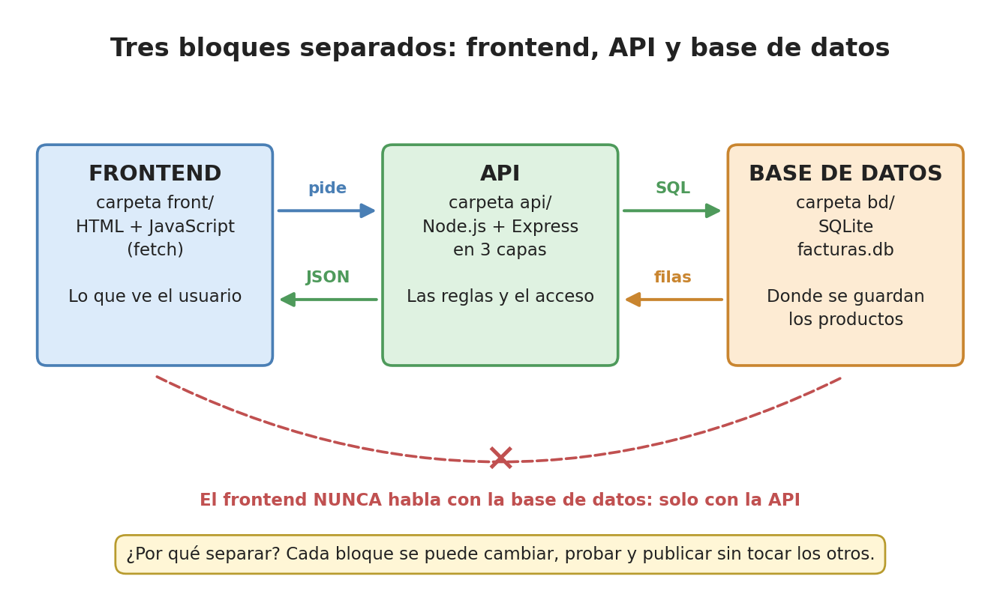
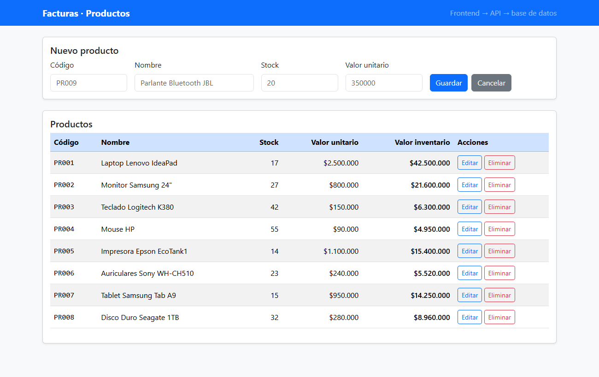
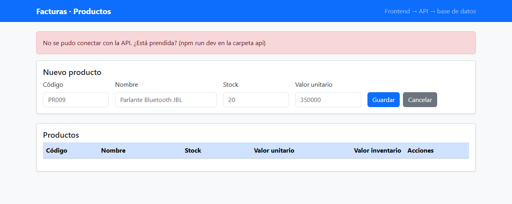
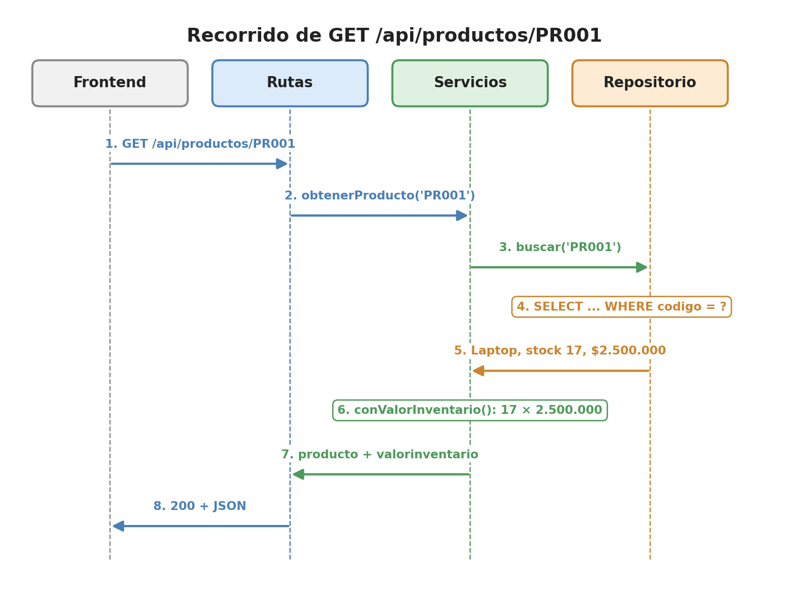

# facturas-app

Ejemplo de clase de **Ingeniería Web I** (IU Digital de Antioquia, 2026-2).

Es una aplicación web completa y sencilla, con una sola tabla (`producto`), organizada en **tres bloques separados**:

| Bloque | Carpeta | Tecnología | Qué hace |
|---|---|---|---|
| 1. Base de datos | `bd/` | SQLite (`node:sqlite`) | Guarda los productos en el archivo `facturas.db` |
| 2. API | `api/` | Node.js + Express, en 3 capas | Entrega y recibe los productos en JSON y aplica las reglas del negocio |
| 3. Frontend | `front/` | HTML + CSS + JavaScript (`fetch`) | La página: muestra, crea, modifica y elimina productos |

Cada bloque de programa tiene **su propia dirección**:

| Bloque | URL | Cómo se prende |
|---|---|---|
| API | http://localhost:3001 | `npm run dev` dentro de `api/` |
| Frontend | http://localhost:3000 | `npm start` dentro de `front/` |



---

## Qué van a hacer ustedes (resumen)

| # | Qué hacen | Para qué | ¿Cuándo? |
|---|---|---|---|
| 0 | Revisar que tienen Node.js y Git | Sin ellos, nada de lo demás funciona | Solo la primera vez |
| 1 | Descargar el proyecto con `git clone` | Tener el código en su computador | Solo la primera vez |
| 2 | Abrir la carpeta en VS Code | Ver el código y tener una terminal a la mano | Cada vez |
| 3 | Instalar las librerías con `npm install` | La API necesita Express y cors | Solo la primera vez |
| 4 | Crear la base de datos con `npm run crear-bd` | Tener la tabla `producto` con 8 productos | Solo la primera vez |
| 5 | Prender la API con `npm run dev` (terminal 1) | Que la API reciba peticiones | **Cada vez** que vayan a trabajar |
| 6 | Ver la API en el navegador | Comprobar que la API responde | Para probar |
| 7 | Prender el frontend con `npm start` (terminal 2) y abrir http://localhost:3000 | Usar la aplicación como usuario | **Cada vez** que vayan a trabajar |
| 8 | Probar todos los endpoints con `pruebas.http` | Probar crear, modificar, eliminar y los errores | Para probar |
| 9 | Leer la guía y los conceptos | Entender **por qué** está organizado así | Antes o después de la clase |

Abajo está cada paso explicado en detalle.

---

## Qué hay en este repositorio

```text
facturas-app/
├── README.md                            # este archivo: qué es y cómo ejecutarlo
├── PASO_A_PASO.md                       # la guía de la clase, paso a paso (también en .docx y .pdf)
├── conceptos/                           # la teoría corta: API, capas, SOLID, Node, React...
│   ├── 00_INDICE.md                     # empiecen por aquí: el orden de lectura
│   └── img/                             # los diagramas (tres bloques, capas, SOLID...)
├── imagenes/                            # capturas de pantalla que usa la guía
├── bd/
│   └── facturas.sql                     # crea la tabla producto y le carga 8 productos
├── api/
│   ├── package.json                     # la ficha del proyecto: librerías y comandos
│   ├── pruebas.http                     # las pruebas de los endpoints (extensión REST Client)
│   └── src/
│       ├── servidor.js                  # prende la API en el puerto 3001
│       ├── crearBd.js                   # ejecuta facturas.sql y crea bd/facturas.db
│       ├── rutas/productoRutas.js               # CAPA 1 · HTTP: recibe la petición y responde con el código correcto
│       ├── servicios/productoServicio.js        # CAPA 2 · reglas: valida y calcula el valor del inventario
│       └── repositorios/productoRepositorio.js  # CAPA 3 · datos: el SQL que lee y escribe en la base
└── front/
    ├── package.json                     # la ficha del frontend: Express y el comando npm start
    ├── servidor.js                      # le da al frontend su URL: http://localhost:3000
    ├── index.html                       # la página: formulario y tabla
    ├── estilos.css                      # la apariencia
    └── app.js                           # conversa con la API usando fetch
```

> Las carpetas `api/node_modules/` y `front/node_modules/`, y el archivo `bd/facturas.db`, **no vienen** en el repositorio: cada uno los crea en su computador en los pasos 3, 4 y 7.

---

## Paso 0 · Revisar que tienen Node.js y Git (solo la primera vez)

*Qué es:* Node.js ejecuta JavaScript fuera del navegador (con él corre la API). Git descarga el proyecto desde GitHub.

*Para qué:* sin ellos no pueden hacer los pasos siguientes.

Abran una terminal (en Windows: tecla Windows, escriban **PowerShell** y Enter) y ejecuten:

```powershell
node -v      # muestra la versión de Node.js
git -v       # muestra la versión de Git
```

✅ Deben ver algo como `v24.13.0` y `git version 2.x`. Node debe ser **22 o superior**.

❌ Si dice *"no se reconoce como comando"*: instalen lo que falte, cierren la terminal y vuelvan a abrirla.
- Node.js: https://nodejs.org (versión **LTS**)
- Git: https://git-scm.com

---

## Paso 1 · Descargar el proyecto (solo la primera vez)

*Qué es:* `git clone` copia el repositorio de GitHub a una carpeta de su computador.

*Para qué:* tener el código para ejecutarlo y estudiarlo.

En la terminal, ubíquense en la carpeta donde guardan sus proyectos (por ejemplo `C:\clases`) y ejecuten:

```powershell
cd C:\clases                                                 # entra a la carpeta de proyectos (créenla si no existe)
git clone https://github.com/ccastro2050/facturas-app.git    # descarga el repositorio
```

✅ Queda una carpeta nueva: `C:\clases\facturas-app`.

> ¿No tienen Git? En la página del repositorio den clic en el botón verde **Code → Download ZIP** y descomprímanlo.

---

## Paso 2 · Abrir la carpeta en VS Code (cada vez)

*Para qué:* ver todos los archivos del proyecto y tener una terminal dentro del mismo programa.

1. Abran VS Code.
2. Menú **File → Open Folder…** (Archivo → Abrir carpeta).
3. Escojan la carpeta `facturas-app` y den clic en **Seleccionar carpeta**.
4. Abran la terminal: menú **Terminal → New Terminal** (o `Ctrl + ñ`).

✅ Abajo aparece una terminal que ya está dentro de `facturas-app`.

---

## Paso 3 · Instalar las librerías (solo la primera vez)

*Qué es:* `npm install` lee el archivo `api/package.json` y descarga las librerías que ahí aparecen: **Express** (crea el servidor) y **cors** (deja que el frontend le hable a la API).

*Para qué:* las librerías no vienen en el repositorio porque pesan mucho; cada uno las descarga.

```powershell
cd api           # IMPORTANTE: entren a la carpeta api, porque ahí está package.json
npm install      # crea la carpeta api/node_modules con Express y cors
```

✅ Debe terminar con: `found 0 vulnerabilities`

---

## Paso 4 · Crear la base de datos (solo la primera vez)

*Qué es:* el comando ejecuta el archivo `bd/facturas.sql`, que crea la tabla `producto` y le inserta 8 productos.

*Para qué:* sin la base de datos, la API no tiene de dónde leer los productos.

```powershell
npm run crear-bd     # (siguen dentro de la carpeta api)
```

✅ Debe decir: `Base de datos creada en bd/facturas.db con 8 productos.`

> Si un día quieren **volver a los 8 productos originales** (por ejemplo, después de borrar varios), ejecuten de nuevo `npm run crear-bd`.

---

## Paso 5 · Prender la API (cada vez que vayan a trabajar)

*Qué es:* `npm run dev` ejecuta `api/src/servidor.js`, que deja la API escuchando peticiones en el **puerto 3001**.

*Para qué:* mientras la API esté apagada, ni el navegador ni el frontend pueden pedir los productos.

```powershell
npm run dev      # (siguen dentro de la carpeta api)
```

✅ Debe decir: `API de facturas en http://localhost:3001`

⚠️ **Esa terminal queda ocupada y NO deben cerrarla.** Si la cierran, o si oprimen `Ctrl + C`, la API se apaga.

> Si necesitan otra terminal para escribir comandos, abran una nueva con el botón **+** del panel de terminal.
>
> El modo `dev` reinicia la API solo cada vez que guardan un cambio en el código.

---

## Paso 6 · Ver la API en el navegador

*Para qué:* comprobar que la API está viva y que entrega los datos en JSON.

Con la API prendida (paso 5), abran en el navegador estas direcciones:

| URL | Qué muestra |
|---|---|
| http://localhost:3001 | Un mensaje que confirma que la API está viva |
| http://localhost:3001/api/productos | Los 8 productos en JSON |
| http://localhost:3001/api/productos/PR004 | Un solo producto (el PR004) |
| http://localhost:3001/api/productos/PR999 | Un error 404: ese producto no existe |

> `localhost` significa **"este mismo computador"**. La API **no está en internet**: solo funciona en el computador donde la prendieron, y solo mientras esté prendida.

---

## Paso 7 · Prender el frontend y abrirlo (cada vez)

*Qué es:* el frontend también tiene su propio servidor (`front/servidor.js`), en el **puerto 3000**. Ese servidor solo entrega la página (`index.html`, `estilos.css` y `app.js`). Por dentro, `app.js` le pide los datos a la API (puerto 3001) con `fetch`.

*Para qué:* ver los tres bloques trabajando juntos, cada uno con su dirección: **página (3000) → API (3001) → base de datos**.

1. **Abran una SEGUNDA terminal** con el botón **+** del panel de terminal. La primera sigue ocupada con la API: no la cierren.
2. En la terminal nueva ejecuten:

```powershell
cd front         # desde la carpeta facturas-app (si están en api, usen: cd ..ront)
npm install      # SOLO LA PRIMERA VEZ: instala Express para el frontend
npm start        # prende el frontend
```

✅ Debe decir: `Frontend de facturas en http://localhost:3000`

3. Abran en el navegador: **http://localhost:3000**

Al final deben tener **dos terminales prendidas**:

| Terminal | Carpeta | Comando | Dice |
|---|---|---|---|
| 1 | `api` | `npm run dev` | `API de facturas en http://localhost:3001` |
| 2 | `front` | `npm start` | `Frontend de facturas en http://localhost:3000` |



Prueben en la página:

| Qué hacer | Qué debe pasar |
|---|---|
| Llenar el formulario con un código nuevo (ej. `PR009`) y dar clic en **Guardar** | El producto aparece en la tabla con un mensaje verde |
| Dar clic en **Editar** en una fila, cambiar el stock y dar clic en **Guardar** | La fila se actualiza |
| Dar clic en **Eliminar** y aceptar | La fila desaparece |
| Guardar con el nombre vacío o el stock negativo | Aparece un mensaje rojo con el error |
| Apagar la API (`Ctrl + C` en la terminal 1) y recargar la página (`F5`) | Aparece *"No se pudo conectar con la API"* |



---

## Paso 8 · Probar todos los endpoints (opcional)

*Para qué:* probar la API directamente, sin la página: crear, modificar, eliminar y los errores 400 y 404.

1. En VS Code, vayan a **Extensions** (`Ctrl + Shift + X`), busquen **REST Client** e instálenla.
2. Abran el archivo `api/pruebas.http`.
3. Encima de cada petición aparece **Send Request**: denle clic, en orden, de la 1 a la 9.
4. A la derecha se abre la respuesta: miren el **código** (200, 201, 204, 400, 404) y el JSON.

| Petición | Código esperado |
|---|---|
| 1. La API está viva | 200 |
| 2. Todos los productos | 200 |
| 3. El PR004 | 200 |
| 4. Un producto que no existe | 404 |
| 5. Crear el PR009 | 201 |
| 6. Datos malos | 400 |
| 7. Código repetido | 400 |
| 8. Modificar el PR009 | 200 |
| 9. Eliminar el PR009 | 204 |

---

## Paso 9 · Entender el código

*Para qué:* saber **por qué** el proyecto está separado en bloques y en capas, y no todo en un solo archivo.

1. Lean `conceptos/00_INDICE.md`: ahí está el orden de lectura (API, capas, SOLID…).
2. Lean la guía `PASO_A_PASO.md` (o el `.pdf`): construye este mismo proyecto desde cero, archivo por archivo, con el código comentado línea por línea.

Así viaja una petición por las tres capas de la API:



---

## Endpoints de la API

| Método | Ruta | Qué hace | Códigos que responde |
|---|---|---|---|
| `GET` | `/api/productos` | Lista todos los productos | 200 |
| `GET` | `/api/productos/:codigo` | Devuelve un producto | 200, 404 |
| `POST` | `/api/productos` | Crea un producto | 201, 400 |
| `PUT` | `/api/productos/:codigo` | Modifica un producto | 200, 400, 404 |
| `DELETE` | `/api/productos/:codigo` | Elimina un producto | 204, 404 |

---

## Si algo falla

| Lo que aparece | Qué significa | Qué hacer |
|---|---|---|
| En el navegador: **"localhost rechazó la conexión"** (`ERR_CONNECTION_REFUSED`) | La API no está prendida | Hagan el paso 5 (`npm run dev`) y dejen esa terminal abierta |
| En la página: **"No se pudo conectar con la API"** | Lo mismo: la API está apagada | Hagan el paso 5 y recarguen la página con `F5` |
| `npm` dice **"Missing script"** o **"ENOENT … package.json"** | Están en la carpeta equivocada | Entren primero a la carpeta `api` (`cd api`) |
| `Cannot find package 'express'` | Faltan las librerías | Hagan el paso 3 (`npm install`) |
| La API responde **500** y la terminal dice `no such table: producto` | Falta la base de datos | Hagan el paso 4 (`npm run crear-bd`) |
| La terminal dice **"el puerto 3001 está ocupado"** | La API ya está prendida en otra terminal | Usen esa terminal, o ciérrenla y vuelvan a ejecutar `npm run dev` |
| En **http://localhost:3000** sale "rechazó la conexión" | El frontend no está prendido | Hagan el paso 7 (`npm start` dentro de `front`) |
| La página abre, pero dice **"No se pudo conectar con la API"** | El frontend está prendido, pero la API no | Prendan la API en la terminal 1 (paso 5) |
| `node` o `git` **no se reconoce como comando** | No está instalado, o la terminal se abrió antes de instalarlo | Hagan el paso 0 y abran una terminal nueva |
