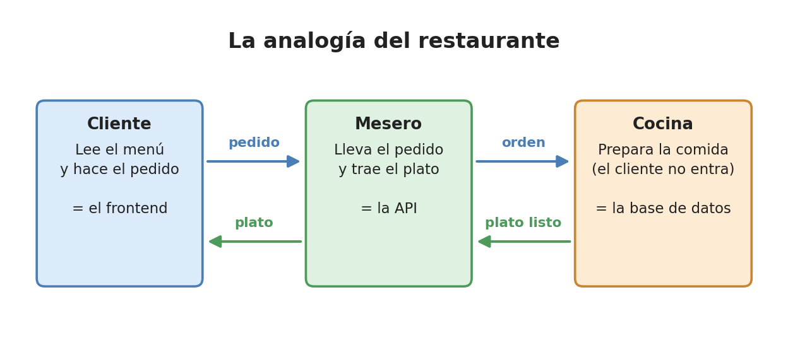
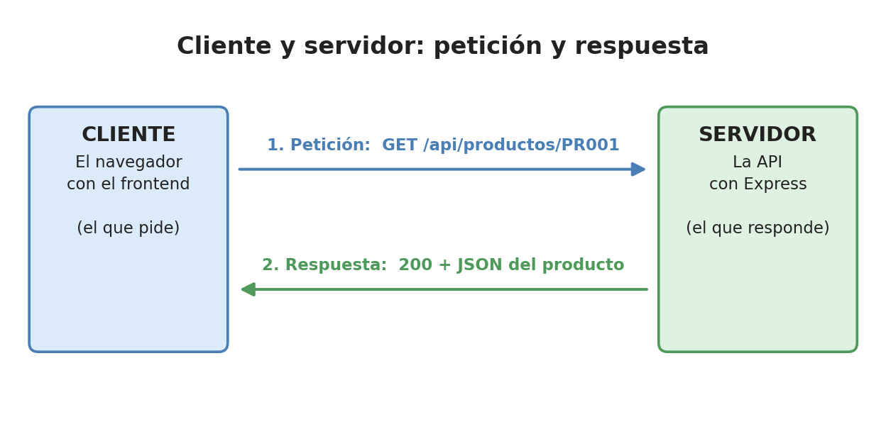

# 1. ¿Qué es una API?

> Aquí van a aprender qué es una API, cómo conversan un cliente y un servidor,
> y qué son los métodos, los códigos de estado y el JSON. En la EA3 lo necesitan
> para construir los endpoints de EcoTienda y para hacer la **tabla de endpoints** del PDF.

## 1.1 La analogía del restaurante



En un restaurante, el cliente no entra a la cocina. Le dice al **mesero** lo que
quiere, el mesero lo lleva a la cocina y vuelve con el plato.

Una **API** (*Application Programming Interface*, interfaz de programación de
aplicaciones) es ese mesero: un programa que **recibe pedidos y entrega
respuestas**, sin que el que pide tenga que saber cómo se preparan.

| Restaurante | Ejemplo de facturas |
|---|---|
| Cliente | El frontend (`front/`) abierto en el navegador |
| Mesero | La API con Express (`api/`) |
| Menú | La lista de endpoints (`GET /api/productos`, ...) |
| Cocina | La base de datos SQLite (`bd/facturas.db`) |

## 1.2 Cliente y servidor, petición y respuesta



- **Cliente**: el que pide. Aquí, el navegador con el frontend (o la extensión REST Client).
- **Servidor**: el que responde. Aquí, la API.
- **Petición** (*request*): el mensaje que manda el cliente.
- **Respuesta** (*response*): el mensaje que devuelve el servidor.

Siempre es igual: **el cliente pide, el servidor responde**. El servidor nunca
habla primero.

## 1.3 HTTP y sus métodos

**HTTP** es el "idioma" en que conversan el cliente y el servidor en la web.
Cada petición lleva un **método** (también llamado verbo) que dice qué se quiere hacer:

| Método | Qué hace | Ejemplo con la tabla `producto` |
|---|---|---|
| `GET` | Pedir (leer) datos | `GET /api/productos` → los 8 productos |
| `POST` | Crear algo nuevo | `POST /api/productos` → crea el `PR009` Parlante Bluetooth JBL |
| `PUT` | Cambiar algo que existe | `PUT /api/productos/PR009` → cambia el parlante |
| `DELETE` | Borrar | `DELETE /api/productos/PR009` → borra el parlante |

Analogía: son las cuatro cosas que se le pueden hacer a un cuaderno:
leer (`GET`), escribir una hoja nueva (`POST`), corregir (`PUT`) y arrancar una hoja (`DELETE`).

## 1.4 Endpoint, parámetros y query

Un **endpoint** (punto de acceso) es la combinación de **método + ruta**.
`GET /api/productos` y `POST /api/productos` son dos endpoints distintos
aunque la ruta sea la misma.

En la URL pueden viajar datos de dos formas:

| Forma | Cómo se ve | Cómo se lee en Express | Para qué |
|---|---|---|---|
| Parámetro de ruta | `/api/productos/PR001` | `req.params.codigo` → `"PR001"` | Señalar **un** producto |
| Query (consulta) | `/api/productos?categoria=solar` (EA3) | `req.query.categoria` → `"solar"` | Filtrar o buscar |

En la ruta se escribe `:codigo`. Los dos puntos dicen "aquí va un valor que cambia":

```js
// "/:codigo" = el valor que vaya en ese lugar de la URL queda en req.params.codigo
rutas.get("/:codigo", (req, res) => {
    // Con GET /api/productos/PR001, req.params.codigo vale "PR001"
    const producto = servicio.obtenerProducto(req.params.codigo);
    // ... (sigue en la sección 1.6)
});
```

## 1.5 JSON: el formato de los datos

**JSON** (*JavaScript Object Notation*) es texto con forma de objeto de JavaScript.
Es el formato en que viajan los datos entre el frontend y la API.
Así se ve el producto `PR001` en la respuesta de la API:

```json
{
  "codigo": "PR001",
  "nombre": "Laptop Lenovo IdeaPad",
  "stock": 17,
  "valorunitario": 2500000,
  "valorinventario": 42500000
}
```

Los cuatro primeros datos son las columnas de la tabla. `valorinventario` **no
está en la tabla**: lo calcula la API (17 × 2.500.000 = 42.500.000).

Diferencias con un objeto de JavaScript: en JSON los nombres van **siempre entre
comillas dobles** y no se permiten comentarios ni funciones.

## 1.6 Códigos de estado

Cada respuesta trae un **código de estado**: un número que dice cómo le fue a la petición.

| Código | Significa | Ejemplo |
|---|---|---|
| **200** OK | Todo bien | `GET /api/productos/PR001` encuentra la laptop |
| **201** Created | Se creó algo | `POST` del `PR009` Parlante Bluetooth JBL |
| **204** No Content | Se hizo, no hay nada que devolver | `DELETE /api/productos/PR009` que sí borró |
| **400** Bad Request | La petición está mal hecha | Datos malos, un código que ya existe (`PR001`), o un JSON mal escrito |
| **404** Not Found | No existe | `GET /api/productos/PR999` |
| **500** Internal Server Error | Falló el servidor | Un error inesperado (lo responde el manejador de errores de `servidor.js`) |

Truco para recordarlos: **2xx** = salió bien, **4xx** = el cliente pidió mal,
**5xx** = el servidor falló.

En Express, el código se pone con `res.status()`. Así sigue la ruta de
`productoRutas.js`:

```js
if (!producto) {                                    // si el servicio no encontró el producto...
    return res.status(404).json({ error: "Producto no encontrado" }); // ...404 y un mensaje
}
res.json(producto);                                 // si lo encontró: 200 (el código por defecto)
```

Y cuando se crea un producto con datos malos (prueba 6 de `pruebas.http`:
código vacío, nombre vacío, stock −3 y valor unitario 0), la API responde **400**
con la lista de errores que encontró `validar()`:

```json
{
  "errores": [
    "El codigo es obligatorio y tiene maximo 10 caracteres.",
    "El nombre es obligatorio.",
    "El stock debe ser un numero entero mayor o igual que 0.",
    "El valor unitario debe ser un numero mayor que 0."
  ]
}
```

## 1.7 Para la EA3

- Prueben cada endpoint con REST Client (`pruebas.http`) o Thunder Client y
  tomen la captura, incluido un error 400 o 404.
- En la tabla de endpoints del PDF pongan: método, ruta, JSON que recibe,
  JSON que devuelve y códigos de estado.
