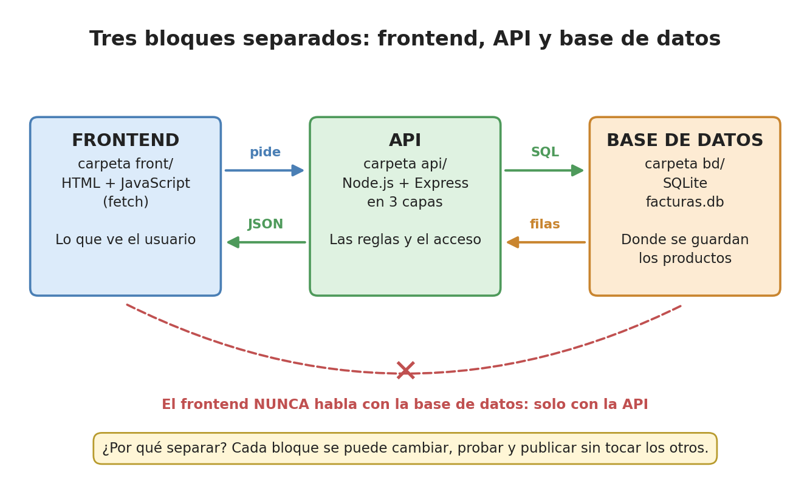
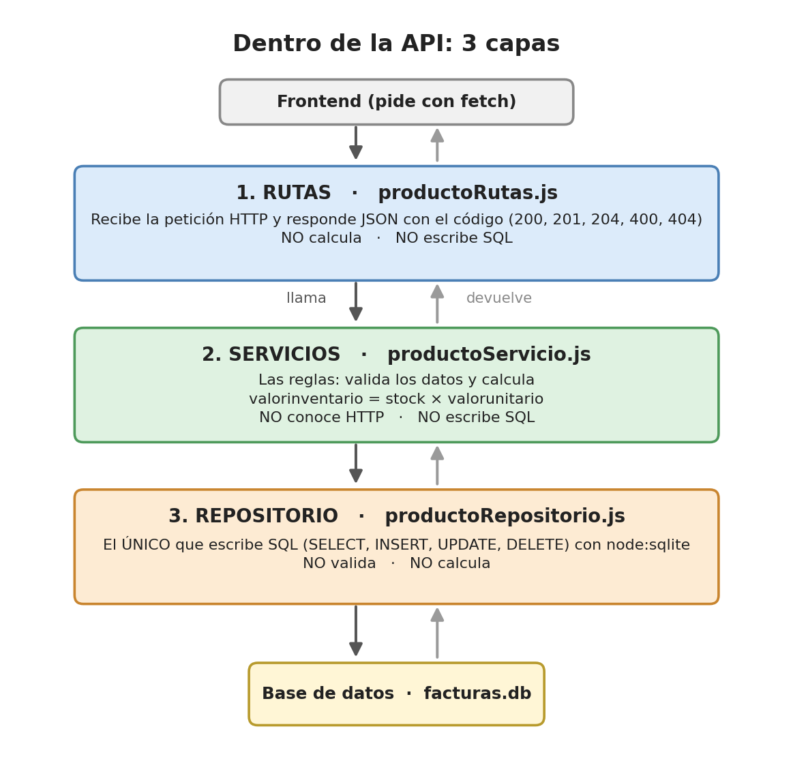
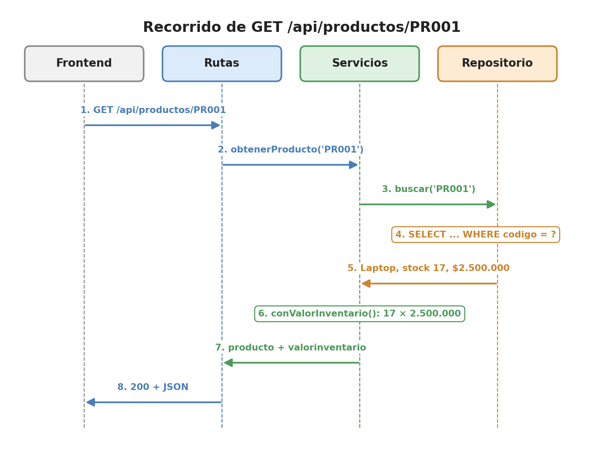

# 3. Tres bloques y tres capas

> Aquí van a aprender por qué el proyecto se separa en **tres bloques** (base de
> datos, API y frontend) y por qué la API, por dentro, se divide en **tres capas**
> (rutas, servicios y repositorio). En la EA3 lo necesitan para el **diagrama de
> arquitectura** y para explicar en el video "el recorrido de una petición por las tres capas".

## 3.1 Primero, los tres bloques



| Bloque | Carpeta | Qué tiene | Habla con... |
|---|---|---|---|
| **Base de datos** | `bd/` | `facturas.sql` (el script) y `facturas.db` (los datos) | Nadie: solo responde a la API |
| **API** | `api/` | Node.js + Express, en 3 capas | Con la base de datos (SQL) y con el frontend (JSON) |
| **Frontend** | `front/` | `index.html`, `estilos.css` y `app.js` (con `fetch`) | **Solo** con la API |

**¿Por qué separarlos?** Porque cada bloque se puede **cambiar, probar y publicar**
sin tocar los otros:

- Se puede rediseñar el frontend sin tocar la API.
- Se puede probar la API sola, con `pruebas.http`, sin abrir el frontend.
- Se podría cambiar SQLite por otro motor de base de datos sin tocar el frontend.

**La regla más importante:** el frontend **nunca** habla con la base de datos.
Si lo hiciera, cualquier persona que abra el navegador podría leer o borrar los
datos. La API es el mesero: decide qué se puede pedir y revisa cada pedido.

La tabla del ejemplo, tal como la crea `bd/facturas.sql`:

```sql
CREATE TABLE producto (                          -- crea la tabla producto
    codigo        TEXT    NOT NULL PRIMARY KEY,  -- 'PR001'. PRIMARY KEY = no se puede repetir
    nombre        TEXT    NOT NULL,              -- 'Laptop Lenovo IdeaPad'. NOT NULL = obligatorio
    stock         INTEGER NOT NULL,              -- cuántas unidades hay en bodega: 17
    valorunitario REAL    NOT NULL               -- cuánto vale una unidad, en pesos: 2500000
);
```

El script se ejecuta con `npm run crear-bd` (desde la carpeta `api`): el archivo
`api/src/crearBd.js` lo lee y crea `bd/facturas.db` con los 8 productos.

## 3.2 Dentro de la API: tres capas

En un restaurante bien organizado, el **mesero** atiende a los clientes, el
**cocinero** prepara la comida y el **bodeguero** guarda los ingredientes.
El mesero no cocina y el cocinero no atiende mesas. La API funciona igual:



| Capa | Archivo | Analogía | SÍ hace | NO hace |
|---|---|---|---|---|
| **1. Rutas** | `src/rutas/productoRutas.js` | Mesero | Recibe la petición HTTP; lee `req.params` y `req.body`; responde JSON con el código (200, 201, 204, 400, 404) | No valida, no calcula, no escribe SQL |
| **2. Servicios** | `src/servicios/productoServicio.js` | Cocinero | Las **reglas del negocio**: `validar()` revisa los datos, no deja repetir un código, y `conValorInventario()` calcula `valorinventario = stock × valorunitario` | No conoce `req`, `res` ni los códigos HTTP; no escribe SQL |
| **3. Repositorio** | `src/repositorios/productoRepositorio.js` | Bodeguero | **Guarda y busca** con SQL: `listar()`, `buscar()`, `crear()`, `actualizar()`, `eliminar()` | No valida, no calcula, no conoce HTTP |

La regla de oro: **cada capa solo habla con la de abajo**. Las rutas llaman a
los servicios; los servicios llaman al repositorio; **solo el repositorio**
habla con la base de datos.

## 3.3 ¿Por qué separar en capas?

| Sin capas (todo en un archivo) | Con capas |
|---|---|
| Para cambiar una regla hay que buscar en todo el código | Las reglas están en un solo lugar: `productoServicio.js` |
| Para cambiar de base de datos hay que reescribir todo | Se cambia **solo** el repositorio |
| Un error puede estar en cualquier parte | Se sabe dónde buscar: ¿es de HTTP, de una regla o del SQL? |
| Difícil trabajar en equipo sin pisarse | Cada integrante puede trabajar en una capa distinta |

## 3.4 El recorrido de una petición: GET /api/productos/PR001



**Paso 1. El frontend pide** la laptop: `GET http://localhost:3001/api/productos/PR001`.

**Paso 2. Capa de rutas** (`productoRutas.js`): saca el código de la URL y se lo
pasa al servicio.

```js
rutas.get("/:codigo", (req, res) => {                            // atiende GET /api/productos/:codigo
    const producto = servicio.obtenerProducto(req.params.codigo); // le pide "PR001" al servicio
    if (!producto) {                                              // si no existe...
        return res.status(404).json({ error: "Producto no encontrado" }); // ...responde 404
    }
    res.json(producto);                                           // si existe: 200 y el JSON
});
```

**Paso 3. Capa de servicios** (`productoServicio.js`): le pide la fila al repositorio.

```js
export function obtenerProducto(codigo) {
    const producto = repositorio.buscar(codigo);             // le pide el producto al repositorio
    return producto ? conValorInventario(producto) : undefined; // si existe, le agrega el cálculo
}
```

**Paso 4. Capa de repositorio** (`productoRepositorio.js`): busca en la base de datos.

```js
export function buscar(codigo) {
    // El ? es un "hueco" que get(codigo) llena con "PR001".
    // Así el texto del usuario nunca se pega dentro del SQL (evita la inyección SQL)
    return bd.prepare("SELECT codigo, nombre, stock, valorunitario FROM producto WHERE codigo = ?")
             .get(codigo);                                    // get: ejecuta y trae UNA fila
}
```

**Paso 5.** La base de datos devuelve la fila: Laptop Lenovo IdeaPad, stock 17,
valor unitario 2.500.000.

**Paso 6. De vuelta en servicios**: `conValorInventario()` aplica la regla del negocio.

```js
function conValorInventario(producto) {
    // un objeto nuevo: todos los datos de la fila (...producto) más el cálculo
    return { ...producto, valorinventario: producto.stock * producto.valorunitario };
}
```

17 × 2.500.000 = **42.500.000**.

**Pasos 7 y 8.** El producto vuelve a la ruta, y la ruta responde **200** con el
JSON que incluye `"valorinventario": 42500000`.

Fíjense: **el 404 lo decide la ruta**, **la cuenta la hace el servicio** y **el
SQL lo escribe el repositorio**. Cada uno hace su parte.

**Otro recorrido para practicar** (prueba 5 de `pruebas.http`): al crear el
`PR009` Parlante Bluetooth JBL (stock 20, valor 350.000), la ruta llama a
`crearProducto()`; el servicio lo valida, revisa con `buscar()` que el código no
exista, le pide a `crear()` que haga el `INSERT`, calcula 20 × 350.000 =
7.000.000, y la ruta responde **201**. Si el código ya existe (prueba 7, `PR001`),
el servicio devuelve el error y la ruta responde **400**.

## 3.5 Lo más valioso: cambiar una pieza sin tocar las demás

Si algún día la empresa decide guardar los productos en otro motor (por ejemplo
PostgreSQL), ¿qué se cambia?

| Archivo | ¿Se cambia? | Por qué |
|---|---|---|
| `front/app.js` | **No** | Sigue pidiendo `GET /api/productos` igual que antes |
| `productoRutas.js` | **No** | Sigue llamando a `servicio.obtenerProducto()` igual que antes |
| `productoServicio.js` | **No** | Sigue llamando a `repositorio.buscar()` igual que antes |
| `productoRepositorio.js` | **Sí** | Es el único que sabe **dónde y cómo** se guardan los datos |

Es como cambiar la bodega de un estante a un cuarto frío: el cocinero sigue
pidiendo "tráeme los tomates" y no le importa dónde estaban guardados.

**En la EA3 pasa justo esto:** la API de EcoTienda empieza con los productos en
un arreglo en memoria y luego se pasa a SQLite cambiando **solo el repositorio**.

## 3.6 Para la EA3

- En el **diagrama de arquitectura** dibujen: el frontend con sus componentes,
  las tres capas de la API, la base de datos y las flechas de petición y respuesta.
- La EA3 exige que **solo el repositorio escriba SQL**. Si aparece SQL en una
  ruta o en un servicio, las capas están mal separadas.
