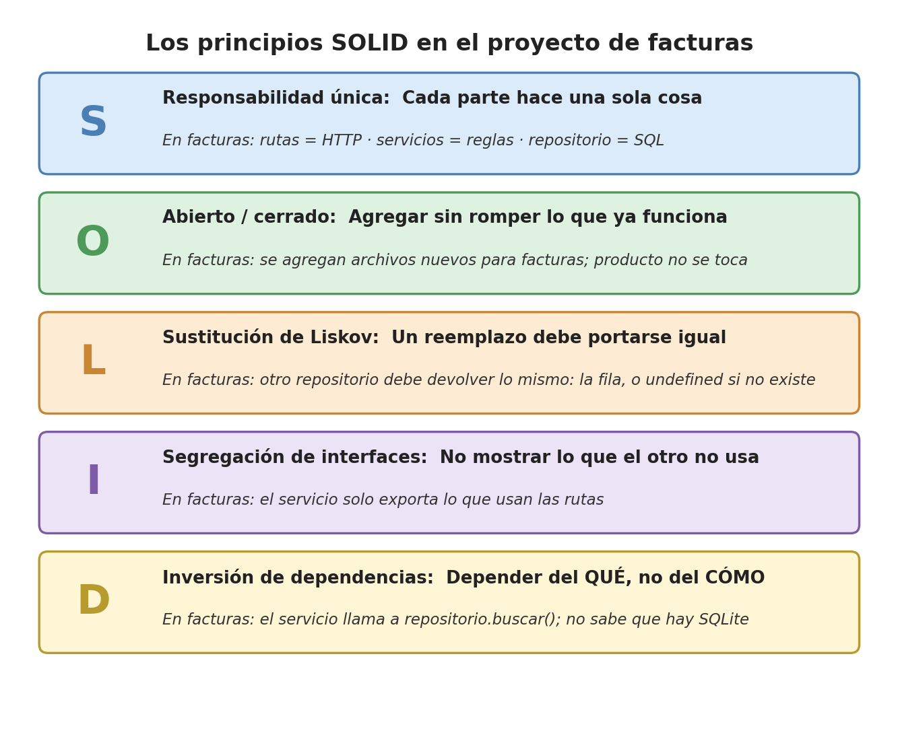

# 4. Los principios SOLID (versión sencilla)

> Aquí van a conocer los cinco principios SOLID: consejos para escribir código
> fácil de cambiar. No hace falta memorizarlos; lo importante es reconocer los
> dos que se ven claramente en el proyecto (la **S** y la **D**), porque explican
> por qué la API está en capas, y eso se sustenta en el video de la EA3.



**SOLID** es una sigla en inglés: cada letra es un principio. Nacieron para
proyectos grandes con muchas clases. En un proyecto pequeño como el de facturas
**algunos se ven claramente y otros apenas se asoman**: en cada caso se dice con
honestidad.

| Letra | Nombre | ¿Se ve en el proyecto? |
|---|---|---|
| **S** | Responsabilidad única | **Sí, claramente** |
| **O** | Abierto/cerrado | Un poco |
| **L** | Sustitución de Liskov | Sí, si se cambia el repositorio |
| **I** | Segregación de interfaces | Más para proyectos grandes |
| **D** | Inversión de dependencias | **Sí, de forma simple** |

---

## S: Responsabilidad única (*Single Responsibility*)

**En una frase:** cada archivo o función debe tener **una sola razón para cambiar**.

**Analogía:** en un hospital, la recepcionista no opera y el cirujano no cobra.

**En el proyecto (se ve claramente):** los tres bloques y las tres capas son justo esto.

| Si cambia... | Se toca solo... |
|---|---|
| El diseño de la página | `front/` |
| Una URL o un código HTTP | `productoRutas.js` |
| Una regla (cómo se calcula `valorinventario`, qué stock es válido) | `productoServicio.js` |
| Una consulta SQL | `productoRepositorio.js` |

---

## O: Abierto/cerrado (*Open/Closed*)

**En una frase:** el código debe estar **abierto para agregarle cosas** pero
**cerrado para modificar** lo que ya funciona.

**Analogía:** a un computador se le conecta una memoria USB sin abrirlo ni soldar nada.

**En el proyecto (un poco):** si se agregan las facturas, se **crean archivos
nuevos** (`facturaRutas.js`, `facturaServicio.js`, `facturaRepositorio.js`) y en
el servidor se **agrega** una línea. Lo de producto no se toca:

```js
app.use("/api/productos", productoRutas); // lo que ya funciona: no se toca
app.use("/api/facturas", facturaRutas);   // lo nuevo: solo se agrega
```

---

## L: Sustitución de Liskov (*Liskov Substitution*)

**En una frase:** si se cambia una pieza por otra, la nueva debe **portarse igual**
para que nada se rompa.

**Analogía:** si se cambia un bombillo por uno LED, debe tener la misma rosca;
si no, no sirve aunque alumbre mejor.

**En el proyecto (sí, si se cambia el repositorio):** si se escribe otro
repositorio (por ejemplo, para otro motor de base de datos), debe devolver
**lo mismo** que el actual, porque el servicio depende de eso:

| Función del repositorio | El servicio espera recibir |
|---|---|
| `buscar(codigo)` | La fila con `codigo`, `nombre`, `stock` y `valorunitario`, o `undefined` si no existe |
| `listar()` | Un arreglo con todas las filas |
| `actualizar(codigo, producto)` | `true` si lo cambió, `false` si no existía |
| `eliminar(codigo)` | `true` si lo borró, `false` si no existía |

Si el repositorio nuevo, por ejemplo, devolviera `stock` como texto (`"17"`), la
cuenta del servicio fallaría: esa es la "rosca" que no encaja.

---

## I: Segregación de interfaces (*Interface Segregation*)

**En una frase:** no obligar a una parte a depender de cosas que **no usa**.

**Analogía:** el control del televisor no trae los botones del aire acondicionado.

**En el proyecto (más para proyectos grandes):** JavaScript no tiene
"interfaces" como Java o C#, así que este principio casi no aparece. Lo más
parecido: `productoServicio.js` **solo exporta** (`export`) las 5 funciones que
usan las rutas (`listarProductos`, `obtenerProducto`, `crearProducto`,
`actualizarProducto`, `eliminarProducto`). `validar()` y `conValorInventario()`
no se exportan: las rutas no las ven porque no las necesitan.

---

## D: Inversión de dependencias (*Dependency Inversion*)

**En una frase:** la parte importante (las reglas del negocio) debe depender de
**qué** se hace, no de **cómo** se hace.

**Analogía:** un enchufe. La nevera necesita "electricidad por un enchufe";
no le importa si viene de la red o de un panel solar.

**En el proyecto (de forma simple):** el servicio solo le pide al repositorio
"dame el producto PR001". **No sabe** que hay SQLite, ni ve una sola línea de
SQL. Por eso se puede cambiar la base de datos sin tocar las reglas.

```js
// productoServicio.js: pide el producto, sin saber CÓMO ni DÓNDE se guarda
const producto = repositorio.buscar(codigo);
```

Siendo honestos: en la versión completa de este principio, el servicio
**recibiría** el repositorio desde afuera (por ejemplo, como parámetro) en vez de
traerlo con `import`. Eso se usa en proyectos grandes; aquí basta con la idea:
**las reglas no dependen de dónde están los datos**.

---

## Para la EA3

En el video, al explicar las capas de EcoTienda, pueden decir: "separamos la API
en tres capas para cumplir la **responsabilidad única**; y como el servicio no
sabe dónde están los datos, pudimos pasar del arreglo a SQLite tocando **solo el
repositorio**".
