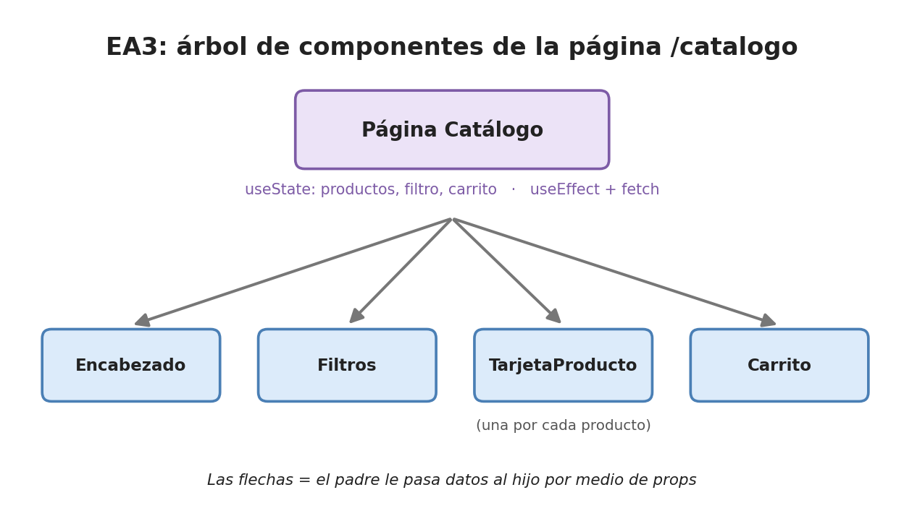

# 6. React y Next.js (para la EA3)

> Aquí van a conocer las ideas básicas de React (componentes, props,
> desestructuración, `useState`, `useEffect`) y de Next.js (páginas y exportación
> estática). En el ejemplo de facturas el frontend es HTML y JavaScript; en la
> **EA3** el frontend de EcoTienda se construye con React y Next.js.

## 6.1 Componente

Un **componente** es una función que devuelve un pedazo de página. Es como una
ficha de LEGO: se arma una vez y se usa muchas veces.

En el frontend de facturas, `app.js` arma cada fila de la tabla con texto HTML
dentro de un `map`. En React, esa "fila" o "tarjeta" sería un componente.



La EA3 pide mínimo estos componentes: `Encabezado`, `TarjetaProducto`, `Filtros` y `Carrito`.

## 6.2 Props y desestructuración

Las **props** (propiedades) son los datos que un componente padre le pasa a un
hijo, como los argumentos de una función. La **desestructuración** saca esos
datos de una vez, entre llaves:

```jsx
// Componente: recibe las props y saca "producto" y "alAgregar" con desestructuración
function TarjetaProducto({ producto, alAgregar }) {
    return (                                              // lo que se dibuja en la página
        <article className="tarjeta">                     {/* el contenedor de la tarjeta */}
            <h3>{producto.nombre}</h3>                    {/* las llaves { } muestran un valor */}
            <p>Ahorro: ${producto.ahorroPesosMes} al mes</p> {/* un dato del producto (EcoTienda, EA3) */}
            <button onClick={() => alAgregar(producto)}>Agregar</button> {/* avisa al padre */}
        </article>
    );
}

// Uso desde el padre: una tarjeta por cada producto
<TarjetaProducto producto={p} alAgregar={agregarAlCarrito} />
```

## 6.3 useState: la memoria del componente

**`useState`** guarda un dato que puede cambiar; cuando cambia, React vuelve a
dibujar el componente solo. Es como un tablero: se borra y se escribe el nuevo valor.

```jsx
const [carrito, setCarrito] = useState([]); // carrito = el valor; setCarrito = la función para cambiarlo; [] = empieza vacío
```

## 6.4 useEffect: hacer algo al abrir la página

**`useEffect`** ejecuta código **después** de dibujar el componente. Con `[]` al
final, se ejecuta **una sola vez**, al abrir la página: el lugar ideal para
pedir los productos a la API.

```jsx
useEffect(() => {                            // se ejecuta después de dibujar la página
    obtenerProductos()                       // la función de lib/api.js (documento 05)
        .then(setProductos)                  // si llegan, los guarda en el estado
        .catch(() => setError("No se pudo conectar con la API")); // si falla, un mensaje claro
}, []);                                      // [] = solo una vez, al abrir la página
```

## 6.5 Next.js y sus páginas

**Next.js** es un marco de trabajo (*framework*) construido sobre React: organiza
las páginas por carpetas. Cada carpeta dentro de `app/` con un `page.js` es una dirección:

```
front/                       # el frontend de la EA3
├── next.config.mjs          # configuración: aquí va output: "export"
├── lib/
│   └── api.js               # las funciones que llaman a la API (fetch)
└── app/                     # las páginas: cada carpeta es una dirección
    ├── page.js              # la página de inicio: /
    ├── catalogo/
    │   └── page.js          # el catálogo con filtros y carrito: /catalogo
    └── admin/
        └── page.js          # el formulario para crear y la tabla para borrar: /admin
```

Las páginas que usan `useState` o `useEffect` empiezan con la línea
`"use client";` para que corran en el navegador.

## 6.6 Exportación estática

Con `output: "export"` en `next.config.mjs`, el comando `npm run build` convierte
el proyecto en **archivos HTML, CSS y JavaScript** normales (carpeta `out/`), que
se pueden publicar en cualquier lado **sin un servidor de Next.js**.

```js
// next.config.mjs
const nextConfig = { output: "export" };  // exportar como archivos estáticos
export default nextConfig;                // entrega la configuración a Next.js
```

Por eso la EA3 dice que no se usan *Server Actions* ni `use cache`: esas funciones
necesitan un servidor de Next.js, y aquí el único servidor es la API de Express.
